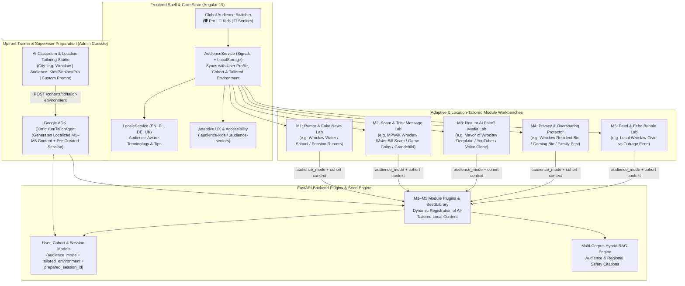

# Multi-Audience Digital Hygiene Platform & AI Trainer Preparation Studio Plan

## Goal Description

The **Infosphere Digital Hygiene Platform (`v3.0.0`)** is currently focused almost exclusively on enterprise and professional cyber defense (e.g., SOC alerts, C2PA cryptographic hardware signatures, SMTP SPF/DKIM/DMARC headers, SCADA grid telemetry, and EU DSA Shannon viewpoint entropy).

This plan introduces two major capabilities across the platform:
1. **Multi-Audience Module Versions (`professional`, `kids`, `seniors`)**:
   - **🧒 Kids (`kids` — Junior Digital Explorers)**: Tailored for school-age youth learning to spot gaming/giveaway scams, viral school rumors, AI-faked influencer videos, social bio oversharing, and outrage clickbait rabbit holes.
   - **👵 Senior Citizens (`seniors` — Silver Shield)**: Tailored for older adults learning to defend against "grandchild in trouble" / fake bank & utility SMS scams, AI voice clones, false health/pension panic rumors, personal data leaks on social media, and alarmist news feeds—enhanced with larger typography and high-clarity controls.
   - **🛡️ Professional (`professional` — Cyber Defense)**: The existing enterprise cognitive defense experience, preserved with **100% backward compatibility**.
2. **Upfront Trainer Session Preparation & AI Location Tailoring Studio**:
   - Designed for **Admins, Trainer Supervisors, and Experienced Trainers** preparing a ready-to-run classroom environment before delivering a course in class.
   - Powered by a **Google ADK `CurriculumTailorAgent`** (`/api/v1/cohorts/{cohort_id}/tailor-environment`) that takes a target **Audience** (`kids`, `seniors`, `professional`), **City / Location** (e.g., *Wrocław*, *Warszawa*, *Kraków*, *Gdańsk*, *Berlin*, *Kyiv*, or any custom city), and optional **Trainer Prompt / Local Entities** (e.g., *Mayor of Wrocław*, *MPWiK Wrocław water utility*), and automatically produces localized scenarios, scams, deepfake samples, OSINT profiles, and feed posts across all 5 modules—plus a **pre-configured, ready-to-launch Classroom Session** (`prepared_session_id`).



---

## Key Architectural Decisions

> [!IMPORTANT]
> **Upfront AI Session Preparation Workflow for Trainers**
> - In the **Admin Cohort Console** (`frontend/src/app/features/admin/admin-cohorts.component.ts`), an admin/supervisor/trainer can open the **AI Classroom & Location Tailoring Studio**.
> - They select the **Target Audience** (`Kids`, `Senior Citizens`, or `Professional`), enter the **City / Location** (e.g., `Wrocław`) and optional local entities (or let the AI agent auto-populate local utilities/officials such as `MPWiK Wrocław` and `Mayor of Wrocław`), and click **"✨ Generate Tailored Class Content with AI"**.
> - The trainer can review/edit the generated M1–M5 scenarios right in the console and click **"🚀 Save & Prepare Classroom Session"**, which dynamically registers the localized scenarios across all 5 modules and creates a ready-to-open M1 simulation session (`prepared_session_id`) so the trainer can walk into class and launch with one click.

> [!IMPORTANT]
> **100% Backward Compatibility & Default Behavior**
> All backend API request models default `audience_mode` to `"professional"`, and all existing scenario/sample IDs (`poland-grid-panic-2026`, `bec-ceo-wire-2026`, `deepfake-grid-minister-video`, etc.) remain unchanged. Existing unit, integration, and golden evaluation tests continue to pass without modification.

> [!TIP]
> **Adaptive Accessibility & Readability**
> - **Senior Citizens Mode (`.audience-seniors`)**: Automatically increases base font sizes and line heights, enlarges interactive buttons/controls, simplifies technical jargon into plain everyday language, and displays a "Golden Safety Rule" callout card in each module.
> - **Kids Mode (`.audience-kids`)**: Uses encouraging, detective-themed language, relatable examples, clear visual badges, and "Cyber Detective Tip" callouts in each module.

---

## Proposed Changes

### Component 1: Backend Models, Users, Cohorts & RAG Corpora

Update backend models and services to store `audience_mode` (`"professional" | "kids" | "seniors"`), store upfront trainer-prepared `tailored_environment` and `prepared_session_id` on cohorts, seed dedicated Kids and Seniors cohorts/users, and index audience-specific safety guidance in the RAG engine.

#### [MODIFY] `backend/app/models/cohort.py`
Add `audience_mode`, `location_name`, `tailored_environment`, and `prepared_session_id` to `Cohort`, plus request/response schemas for the AI Location Tailoring Studio:
```python
class LocationTailoringRequest(BaseModel):
    city_name: str = Field(default="Wrocław", description="Target city or region, e.g. Wrocław")
    audience_mode: str = Field(default="seniors", description="professional | kids | seniors")
    language: str = Field(default="pl", description="en | pl | de | uk")
    local_mayor_or_leader: Optional[str] = Field(
        default=None, description="e.g. Mayor of Wrocław / Prezydent Miasta Wrocławia"
    )
    local_water_or_utility: Optional[str] = Field(
        default=None, description="e.g. MPWiK Wrocław"
    )
    local_institution_or_school: Optional[str] = Field(
        default=None, description="e.g. Urząd Miejski Wrocławia / Wrocław Senior Center"
    )
    trainer_notes: Optional[str] = Field(
        default="", description="Free-text trainer instructions for the AI agent"
    )
    create_ready_session: bool = Field(
        default=True, description="Automatically pre-create a ready-to-launch M1 session"
    )


class TailoredModuleContent(BaseModel):
    city_name: str
    audience_mode: str
    language: str
    local_entities: Dict[str, str]
    m1_scenario: Dict[str, Any]
    m2_scam_scenario: Dict[str, Any]
    m3_deepfake_sample: Dict[str, Any]
    m4_osint_preset: Dict[str, Any]
    m5_echo_feed: List[Dict[str, Any]]
    trainer_briefing: str
    adk_agent_name: str = "curriculum_location_tailor_agent"


class Cohort(BaseModel):
    id: str
    name: str
    description: str = ""
    audience_mode: str = "professional"  # "professional" | "kids" | "seniors"
    location_name: str = "National / Default"
    prepared_session_id: Optional[str] = None
    tailored_environment: Optional[TailoredModuleContent] = None
    created_by: str = "admin"
    created_at: float = Field(default_factory=lambda: time.time())
    is_active: bool = True
    module_configs: Dict[str, CohortModuleConfig] = Field(default_factory=dict)
    assigned_user_ids: List[str] = Field(default_factory=list)
```

#### [MODIFY] `backend/app/models/user.py`
Add `audience_mode: str = "professional"` to `User`, `UserPublic`, and `UserRegisterRequest`.

#### [MODIFY] `backend/app/models/session.py` & `backend/app/api/v1/sessions.py`
Add `audience_mode: str = "professional"` and `location_name: Optional[str] = None` to `Session` and `CreateSessionRequest`.

#### [MODIFY] `backend/app/services/cohort_service.py` & `backend/app/api/v1/cohorts.py`
1. Seed two additional cohorts alongside `cohort_cyber_defense_2026` in `CohortService._seed_default_cohort`:
   - `cohort_kids_explorers_2026`: *"Junior Digital Explorers (Kids)"*, `audience_mode="kids"`, default M1 scenario `kids-school-snowday-rumor-2026`.
   - `cohort_silver_shield_2026`: *"Silver Shield Digital Safety — Wrocław Seniors"*, `audience_mode="seniors"`, pre-configured with a Wrocław localized environment (`MPWiK Wrocław` water scam, `Mayor of Wrocław` deepfake, and `seniors-pension-health-rumor-2026`) so trainers can see an example out of the box.
2. Add `POST /api/v1/cohorts/{cohort_id}/tailor-environment` in `backend/app/api/v1/cohorts.py`:
   - Invokes the Google ADK `CurriculumTailorAgent` (`adk_runtime.build_llm_agent` + `invoke_structured` with deterministic city-aware synthesis fallback).
   - Dynamically registers the generated M1 scenario in `SeedLibrary`, M2 scam scenario in `Module2ScamLabPlugin`, M3 media sample in `MEDIA_LAB_CATALOG`, M4 preset in `Module4OSINTExposurePlugin`, and M5 feed posts in `Module5AlgoEchoPlugin`.
   - Pre-creates an M1 `Session` (stored in `cohort.prepared_session_id`) seeded with the localized starter post so the trainer can enter the classroom immediately.

#### [MODIFY] `backend/app/services/user_service.py` & `backend/app/api/v1/auth.py`
Seed two new demo accounts in `UserService._seed_default_users` and expose them in `/api/v1/auth/demo-users`:
- `kid1`: `Leo Nowak (Junior Explorer)`, `cohort_id="cohort_kids_explorers_2026"`, `audience_mode="kids"`
- `senior1`: `Marta Kowalska (Senior Citizen)`, `cohort_id="cohort_silver_shield_2026"`, `audience_mode="seniors"`

#### [MODIFY] `backend/app/platform/rag_engine.py`
Extend `DEFAULT_PLATFORM_CORPORA` with kid-, senior-, and municipal-utility-focused authoritative chunks (`KIDS-ONLINE-SAFETY-2026`, `SENIOR-SCAM-SHIELD-2026`, `MUNICIPAL-UTILITY-IMPOSTOR-2026`, `MAYOR-DEEPFAKE-PROVENANCE-2026`, `KIDS-PRIVACY-HERO-2026`, `SENIOR-DATA-GUARD-2026`).

---

### Component 2: Backend 5 Module Plugins & Seed Library (Kids, Seniors & Location-Tailored Content)

Adapt all 5 backend module plugins and `backend/app/ai/seed_library.py` to support:
1. Built-in `kids` and `seniors` scenarios and samples across all 4 languages (`en`, `pl`, `de`, `uk`).
2. Dynamic registration of trainer-tailored city scenarios (e.g., Wrocław `MPWiK Wrocław` water supplier scam, `Mayor of Wrocław` deepfake briefing, Wrocław municipal rumors, Wrocław OSINT profile, and Wrocław echo-chamber feed).

#### [MODIFY] `backend/app/ai/seed_library.py` & `backend/app/modules/m1_disinfo/plugin.py` (Module 1: Rumor & Fake News Lab)
1. Add `audience_mode` metadata to `SCENARIOS_DATA` and add built-in multi-language scenarios for Kids and Seniors:
   - **Kids Scenario (`kids-school-snowday-rumor-2026`)**: *"School Closure & Free Game Tablet Rumor"* (`pl`: *"Plotka o Zamknięciu Szkół i Darmowych Tabletach"*).
   - **Seniors Scenario (`seniors-pension-health-rumor-2026`)**: *"False Pharmacy Shortage & Pension Freeze Rumor"* (`pl`: *"Fałszywy Alarm o Braku Leków i Wstrzymaniu Emerytur"*).
2. Add `SeedLibrary.register_custom_scenario(scenario_dict)` so the AI Trainer Studio can dynamically register localized city scenarios (e.g., `tailored-wroclaw-mpwik-2026`: *"Wrocław Water Supply (MPWiK) & Municipal Alert Rumor"*).

#### [MODIFY] `backend/app/modules/m2_scam_lab/plugin.py` (Module 2: Scam & Trick Message Lab)
1. Extend `StartScamDrillRequest` to accept `audience_mode: str = "professional"` and arbitrary registered `scenario_id: str = "bec-ceo-wire-2026"` (supporting both built-in and trainer-tailored scenario IDs):
   - **Kids Scenarios**:
     - `kids-robux-skin-scam-2026`: *"Free Game Coins & Rare Skin Prize!"*
     - `kids-fake-friend-chat-2026`: *"Hacked Classmate: 'Vote for My School Contest!'"*
   - **Seniors Scenarios**:
     - `seniors-grandchild-emergency-2026`: *"Grandchild in Trouble — Urgent Cash/Courier Request"*
     - `seniors-parcel-bank-sms-2026`: *"Unpaid Parcel Fee & Pension Bank Account Alert"*
     - `tailored-wroclaw-water-scam-2026` (and any AI-generated city utility scam): e.g., *"MPWiK Wrocław: Urgent Water Shutoff & Unpaid Invoice Scam"* (`"PILNE [MPWiK Wrocław]: W związku z niedopłatą 14,50 zł dostawa wody pod Twój adres we Wrocławiu zostanie wstrzymana o 15:00..."`).
2. Add `GET /api/v1/modules/m2-scam/scenarios?audience_mode=...` so the frontend dropdown automatically lists both the built-in scenarios for that audience and any trainer-tailored local scenarios (such as the Wrocław MPWiK scam).
3. Update `inspect_sender_headers`, `lookup_domain_whois`, and `verify_out_of_band_callback` to return scenario-specific headers, WHOIS, callback statements (e.g., calling the official MPWiK Wrocław helpline), and plain-language explanations.

#### [MODIFY] `backend/app/modules/m3_deepfake_lab/plugin.py` (Module 3: Real or AI Fake? Media Lab)
1. Add `audience_mode: str = "professional"`, `location_tag: Optional[str] = None`, and `plain_markers: List[str]` to `MediaArtifactSample`.
2. Expand `MEDIA_LAB_CATALOG` with Kids, Seniors, and Location-Tailored samples:
   - **Kids Samples**:
     - `kids-youtuber-giveaway-video` (`VIDEO_SNIPPET`, synthetic): Famous gaming streamer supposedly giving away free consoles.
     - `kids-voice-prank-principal` (`AUDIO_VOICE_CLONE`, synthetic): Fake voice note of the school principal canceling homework.
     - `kids-verified-school-dog-photo` (`IMAGE`, authentic): Verified school science fair photo.
   - **Seniors & Localized Samples**:
     - `seniors-wroclaw-mayor-deepfake` (`VIDEO_SNIPPET`, synthetic): *"Urgent Appeal: Mayor of Wrocław Announces Emergency Water Rationing & Fee Collection"* (lip-sync delay, unnatural eye reflections, missing official city hall C2PA signature, AI SynthID watermark detected).
     - `seniors-grandson-voice-clone` (`AUDIO_VOICE_CLONE`, synthetic): WhatsApp voice note sounding like a grandchild crying and asking for urgent money.
     - `seniors-verified-townhall-photo` (`IMAGE`, authentic): Verified municipal photo with valid hardware camera signature.
3. Add `register_custom_sample(sample: MediaArtifactSample)` so when a trainer configures any city (e.g., Wrocław, Kraków, Gdańsk, Berlin), the AI agent registers a custom deepfake sample of that city's Mayor / Public Figure directly into `MEDIA_LAB_CATALOG`.

#### [MODIFY] `backend/app/modules/m4_osint_exposure/plugin.py` (Module 4: Privacy & Oversharing Protector)
1. Add `audience_mode: str = "professional"` and `language: str = "en"` to `OSINTFootprintSubmission`.
2. Add `GET /api/v1/modules/m4-osint/presets?audience_mode=...` returning audience- and location-tailored profile presets (including trainer-configured local presets, e.g., a Wrocław resident posting their MPWiK Wrocław contract details, phone number, IBAN, and Wrocław GPS coordinates).
3. Tailor `simulated_attacker_pretext` and `remediation_checklist` in `analyze_footprint` for Kids, Seniors, and localized city contexts.

#### [MODIFY] `backend/app/modules/m5_algo_echo/plugin.py` (Module 5: Feed & Echo Bubble Lab)
1. Add `audience_mode: str = "professional"` and `city_name: Optional[str] = None` to `RecommenderTuningRequest`.
2. Add audience-specific candidate pools (`KIDS_CANDIDATE_POOL`, `SENIORS_CANDIDATE_POOL`) plus dynamic injection of trainer-tailored local city headlines (e.g., Wrocław neighborhood/utility outrage bait vs. verified Wrocław civic audit and community workshops).
3. Tailor `adk_coach_explanation` in `simulate_feed` into friendly, jargon-free language for Kids and Seniors.

---

### Component 3: Frontend Core `AudienceService`, `LocaleService` & Adaptive Styling

#### [NEW] `frontend/src/app/core/audience/audience.service.ts`
Create `AudienceService` using Angular Signals:
- Manages `mode = signal<AudienceMode>('professional')` (`'professional' | 'kids' | 'seniors'`), persisted in `localStorage`.
- Stores active `tailoredEnvironment = signal<any | null>(null)` fetched from the active Cohort so all 5 modules know when a trainer has configured localized city content (e.g., `city_name: "Wrocław"`, `prepared_session_id`, and custom M1–M5 scenarios/presets).
- Exposes computed helpers: `isProfessional()`, `isKids()`, `isSeniors()`, `activeLocationName()`.

#### [MODIFY] `frontend/src/styles.css`
Add adaptive audience classes:
- `.audience-seniors`: Scales up body/card typography, increases line-height, adds high-contrast borders and larger click targets on buttons and inputs.
- `.audience-kids`: Softens harsh terminal styling with rounded corners, warm accent borders, and playful badge highlights.

#### [MODIFY] `frontend/src/app/core/i18n/locale.service.ts` & `frontend/public/assets/i18n/{en,pl,de,uk}.json`
- Add `audience` and `trainer_studio` dictionary sections across all 4 languages (`en`, `pl`, `de`, `uk`) covering Kids, Seniors, and the AI Classroom & Location Tailoring Studio.

---

### Component 4: Frontend Shell, Auth, Dashboard & Upfront AI Trainer Studio

#### [MODIFY] `frontend/src/app/features/admin/admin-cohorts.component.ts`
Add the **Upfront Trainer Session Preparation & AI Location Tailoring Studio** panel to the Cohort Console:
1. **Cohort Audience & Location Selector**:
   - Select **Target Audience**: `🛡️ Professional Cyber Defense`, `🧒 Kids (Junior Explorers)`, `👵 Senior Citizens (Silver Shield)`.
   - Enter **City / Location**: e.g., `Wrocław` (with quick-fill city chips: `Wrocław`, `Warszawa`, `Kraków`, `Gdańsk`, `Berlin`, `Kyiv`).
   - Optional **Local Entities & Trainer Prompt**:
     - *Local Public Figure / Mayor*: e.g., `Prezydent Wrocławia (Mayor of Wrocław)`
     - *Local Utility / Company*: e.g., `MPWiK Wrocław (Wrocław Water Supplier)`
     - *Local Institution / School / Senior Club*: e.g., `Wrocławskie Centrum Seniora / Urząd Miejski Wrocławia`
     - *AI Co-Pilot Prompt*: Free-text instructions for the AI agent to tailor the class.
2. **1-Click AI Generation & Live Preview**:
   - Clicking **"🤖 Generate Localized Class Environment with AI"** calls `POST /api/v1/cohorts/{cohort_id}/tailor-environment`.
   - Displays a structured preview of the AI-generated class package across all 5 modules:
     - **M1**: Localized Rumor Scenario + Pre-created Classroom Session link (`/arena/:sessionId` & `/classroom/:sessionId`)
     - **M2**: Localized Scam Drill (e.g., *MPWiK Wrocław Water Supplier Scam*)
     - **M3**: Localized Deepfake Sample (e.g., *Mayor of Wrocław Emergency Video Deepfake*)
     - **M4**: Localized Privacy/OSINT Profile Preset
     - **M5**: Localized Echo Chamber Headlines
   - Includes a **"🚀 Open Prepared Classroom Session"** button so the trainer can immediately test or project the configured session in class.

#### [MODIFY] `frontend/src/app/features/platform-shell/platform-shell.component.ts`
1. Bind `[ngClass]="{ 'audience-kids': audience.isKids(), 'audience-seniors': audience.isSeniors() }"` on the root wrapper.
2. Add the **Global Audience Switcher** pill bar in the header (`🛡️ Pro`, `🧒 Kids`, `👵 Seniors`) and a **Location Badge** (e.g., `📍 Wrocław`) when a localized cohort environment is active.
3. Update navigation tab labels (`M1`–`M5`) to use audience-friendly titles.
4. Add quick-switch options in the header/login for `🧒 Kid` (`kid1`) and `👵 Senior` (`senior1`).

#### [MODIFY] `frontend/src/app/core/auth/auth.service.ts`, `frontend/src/app/features/auth/login.component.ts` & `frontend/src/app/features/dashboard/player-dashboard.component.ts`
- Extend `quickSwitchUser` to support `'kid1'` and `'senior1'` and automatically sync `AudienceService` with the user's `audience_mode` and cohort's `tailored_environment`.
- Show the active Audience Track and Location Tailoring banner on the Player Dashboard, including a direct **"Join Trainer's Prepared Session"** button if the cohort has a `prepared_session_id`.

---

### Component 5: Frontend 5 Module Workbenches

Update all 5 module UI components to react to `AudienceService.mode()` and `AudienceService.tailoredEnvironment()`:

#### [MODIFY] `frontend/src/app/features/lobby/lobby.component.ts`, `frontend/src/app/features/lab-arena/arena.component.ts`, `frontend/src/app/features/lab-arena/components/red-console/red-console.component.ts` & `frontend/src/app/features/lab-arena/components/blue-console/blue-console.component.ts` (Module 1)
- Dynamically load scenarios from `/api/v1/admin/scenarios` (including Kids, Seniors, and AI-tailored local city scenarios like Wrocław) and highlight any trainer-prepared session so the class can join in 1 click.
- Adapt action names and descriptions in the Red and Blue consoles for `kids` and `seniors`.

#### [MODIFY] `frontend/src/app/features/modules/m2-scam-lab/m2-scam-lab.component.ts` (Module 2)
- Populate the Scenario Selector from `/api/v1/modules/m2-scam/scenarios?audience_mode=...` so it includes the audience's scenarios (`kids-robux-skin-scam-2026`, `seniors-grandchild-emergency-2026`, etc.) **plus** any trainer-tailored local utility scam (e.g., *MPWiK Wrocław Water Supplier Scam*).
- Present plain-language tool buttons and evidence explanations for Kids and Seniors.

#### [MODIFY] `frontend/src/app/features/modules/m3-deepfake-lab/m3-deepfake-lab.component.ts` (Module 3)
- Fetch samples for the active `audience_mode` (including trainer-tailored samples such as the *Mayor of Wrocław* deepfake video).
- Provide audience-friendly forensic clue checkboxes and plain-language 3-step explanations for Kids and Seniors.

#### [MODIFY] `frontend/src/app/features/modules/m4-osint-lab/m4-osint-lab.component.ts` (Module 4)
- Provide Kids presets, Seniors presets, and a **"📍 Local City Preset"** button (e.g., Wrocław resident profile with MPWiK/local details) when a tailored environment is active.

#### [MODIFY] `frontend/src/app/features/modules/m5-echo-lab/m5-echo-lab.component.ts` (Module 5)
- Adapt slider labels, presets, and feed items for `kids`, `seniors`, and the trainer-configured `city_name`.

---

## Verification Plan

### Automated Tests
1. **Backend Unit, Integration & Golden Eval Tests**:
   Run the existing pytest suite plus new integration tests verifying:
   - `kids` and `seniors` modes across all 5 modules, cohorts, and demo users (`kid1`, `senior1`).
   - Upfront Trainer AI Location Tailoring (`POST /api/v1/cohorts/{cohort_id}/tailor-environment` with `city_name="Wrocław"`, `local_mayor_or_leader="Mayor of Wrocław"`, `local_water_or_utility="MPWiK Wrocław"`) verifying that localized content is generated and registered across M1–M5 and that a pre-configured `prepared_session_id` is created.
   ```bash
   cd backend && pytest
   ```
2. **Frontend Build Verification**:
   ```bash
   cd frontend && npm run build
   ```

### Manual Verification
1. Log in as **Admin / Trainer Supervisor** (`admin`) and open **Cohort Console** (`/admin/cohorts`).
2. Use the **AI Classroom & Location Tailoring Studio** to configure a session for **Wrocław** (e.g., with *Mayor of Wrocław* and *MPWiK Wrocław*) for **Senior Citizens** or **Kids**, and verify that the AI agent generates the localized M1–M5 package and pre-creates a ready session.
3. Switch between `🛡️ Pro`, `🧒 Kids`, and `👵 Seniors` in the top header and verify that all 5 modules display the localized Wrocław scenarios/samples alongside the audience-appropriate terminology and readability enhancements.
