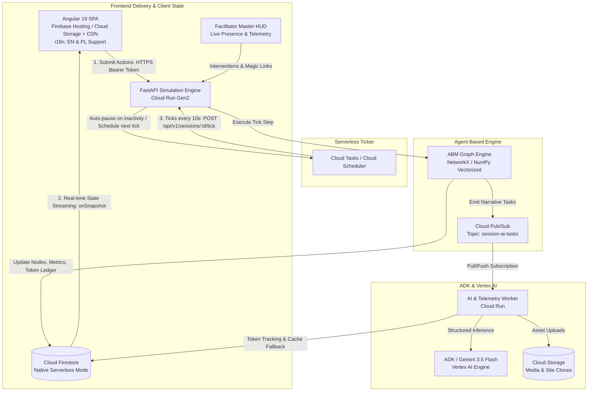
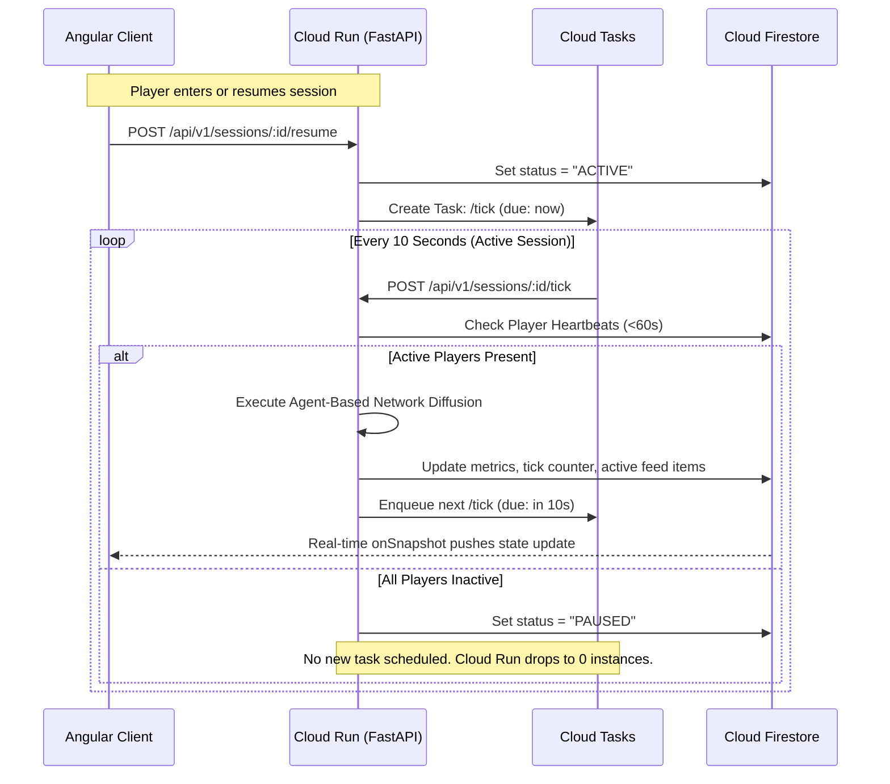
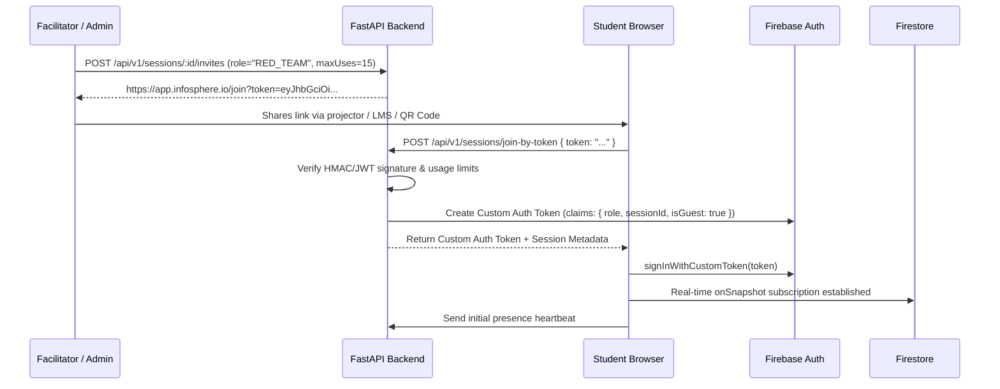

# Technical Specification: Infosphere Lab Module (Version 2.1 Hardened)

## 1. System Overview & Architectural Strategy

The **Infosphere Lab** is the interactive multi-player and single-player simulation engine of the Digital Hygiene Learning Platform. It immerses learners in realistic, fast-paced scenarios mimicking modern social media feeds, algorithmic amplification, coordinated inauthentic behavior (CIB), and information defense.

### 1.1 Core Requirements & Design Tenets
1. **True Scale-to-Zero Serverless:** Inactive labs incur zero compute costs. Simulation ticks and background mechanics execute on-demand without persistent server overhead.
2. **Agent-Based Simulation (ABM):** Replaces simplistic scalar formulas with discrete simulated persona agents reacting, sharing, polarizing, or resisting across a realistic social network graph.
3. **Decoupled Real-time Topology:** Client reads stream directly from Cloud Firestore (`onSnapshot`). Client actions execute via authenticated HTTPS endpoints on Cloud Run. Real-time broadcast does not depend on fragile API Gateway streaming.
4. **Resilient AI Pipeline:** Vertex AI (Gemini 3.5 Flash) and the Agent Development Kit (ADK) are utilized with strict schema validation (`responseSchema`) and asynchronous queueing for synthetic narrative generation, bot personas, and counter-comments without blocking simulation clock ticks.
5. **Frictionless Onboarding:** Magic signed join links allow students and participants to jump directly into designated team roles without email/password registration.
6. **Multi-Language Native (i18n):** Full localization support for English (`en`) and Polish (`pl`) across all UI strings, game prompts, feed assets, and synthetic content generation.
7. **Comprehensive Token & Cost Governance:** Real-time token consumption tracking, soft/hard caps, and an automatic fallback circuit breaker to pre-generated seed libraries.
8. **Facilitator Master HUD:** Live real-time surveillance of student actions, contagion spread, audience sentiment, and manual game intervention tools.
9. **Automated Infrastructure as Code (IaC):** 100% turnkey deployment into a single Google Cloud project via Terraform.

---

## 2. Target GCP System Architecture



### 2.1 GCP Component Mapping & Cost Profile

| Component | GCP Service | Scaling Policy | Justification & Zero-Cost Behavior |
| :--- | :--- | :--- | :--- |
| **Frontend Hosting** | Firebase Hosting / Cloud Storage + CDN | Edge Static Delivery | Zero server compute; global CDN caching; free tier coverage for static assets. |
| **Simulation API** | Cloud Run (FastAPI Container) | `minScale: 0`, `maxScale: 100`, `cpu-throttling: true` | Scales to zero when no HTTP requests arrive. Handles actions and tick execution. |
| **Tick Orchestrator** | Cloud Tasks | Serverless Queue | Fires tick HTTP requests at 10s intervals. Self-terminates when all participants disconnect. |
| **Simulation State & Feed** | Cloud Firestore | Serverless Native Mode | Document-level real-time synchronization (`onSnapshot`) to all connected Angular clients. |
| **Event Pipeline** | Cloud Pub/Sub | Fully Managed Message Bus | Offloads expensive LLM narrative generation from the sub-second tick loop. |
| **Generative AI** | Vertex AI (Gemini 3.5 Flash) + ADK | On-demand API calls | Ultra-fast token generation (<600ms) with enforced JSON schema for synthetic comments and headlines. |
| **Asset Storage** | Cloud Storage (GCS) | Multi-Region Bucket | Stores spoofed media, news site screenshots, deepfake artifacts, and avatar assets. |
| **Identity & Access** | Firebase Authentication | Identity Platform | Secure JWT issuance; Anonymous Auth + Custom Signed Tokens for frictionless guest access. |

---

## 3. Scale-to-Zero Simulation Clock & Lifecycle

### 3.1 The Ticking Problem & Solution
Cloud Run containers with `cpu-throttling: true` freeze CPU execution between requests. In-memory `setInterval` loops are not viable. 

**The Solution:**
1. A session is created with `status = "LOBBY"`.
2. When the Facilitator starts the scenario, the API transitions the session to `status = "ACTIVE"`, writes the initial state, and enqueues a Cloud Task targeted at:
   `POST /api/v1/sessions/{sessionId}/tick` with an execution delay of `0` seconds.
3. Upon receiving the tick request:
   - The engine validates that the session is still active and that active player heartbeats exist within the last 60 seconds.
   - If active players are present:
     - The engine advances the simulation by 1 tick (representing 1 hour of game time).
     - It executes the Agent-Based social network diffusion cycle.
     - It computes updated metrics, evaluates token caps, and writes changed feed items and aggregated indices to Firestore.
     - It enqueues the *next* tick in Cloud Tasks with `scheduleTime = now + 10s`.
   - If no active player heartbeats exist within the last 60 seconds:
     - The engine updates `status = "PAUSED"` in Firestore.
     - No further Cloud Task is scheduled.
     - Cloud Run scales down to zero instances.
4. When any participant reconnects or the instructor hits "Resume", the API receives the client request, sets `status = "ACTIVE"`, and dispatches the kickoff Cloud Task.



---

## 4. Agent-Based Simulation (ABM) Engine

### 4.1 Audience Network Graph Structure
The audience is modeled as a directed scale-free network (Barabási–Albert with clustering or Holme-Kim power law) composed of $N = 200$ to $500$ discrete simulated user nodes.

Each node $i$ maintains internal psychological and behavioral states:
* $\text{cluster}_i \in \{\text{Hyper-Partisan A}, \text{Hyper-Partisan B}, \text{Institutional / Skeptics}, \text{Susceptible Neutrals}, \text{Youth / Apolitical}\}$
* $T_i \in [0.0, 1.0]$: Institutional Trust (confidence in mainstream reporting and authority).
* $O_i \in [0.0, 1.0]$: Outrage Sensitivity (susceptibility to inflammatory, emotionally charged language).
* $B_i \in [-1.0, 1.0]$: Ideological Bias (affinity toward specific political or narrative polarities).
* $C_i \in [0.0, 1.0]$: Confirmation Bias Strength (penalizes counter-attitudinal evidence).
* $M_i \in [0.0, 1.0]$: Prebunk Resistance Factor (immunity to manipulation generated by Blue Team preemptive education).
* $\text{state}_i \in \{\text{UNAWARE}, \text{EXPOSED}, \text{BELIEVING}, \text{SHARING}, \text{DEBUNKING}\}$

### 4.2 Mathematical Propagation Model per Tick
On each tick $t$, every active post $k$ in the feed traverses the network graph:

#### 1. Node Exposure Probability
A node $i$ is exposed to post $k$ if:
* Any followed neighbor $j \in \text{InNeighbors}(i)$ shared post $k$ at tick $t-1$.
* OR post $k$ was boosted by Red Team algorithmic targeting / bot injection:
  $$P(\text{Expose}_{i,k}) = 1 - \prod_{j \in \text{Sharers}} (1 - w_{j,i}) \times (1 - \text{AlgoBoost}_k)$$

#### 2. Amplification / Reshare Probability
If exposed, the probability that node $i$ amplifies post $k$ is given by:
$$P(\text{Share}_{i,k}) = \sigma \left( \alpha \cdot \text{Outrage}_k \cdot O_i + \beta \cdot (1 - |B_i - \text{Bias}_k|) \cdot C_i - \gamma \cdot \text{PrebunkShield}_{i,k} - \delta \cdot \text{FactCheckFriction}_k \right)$$
where:
* $\sigma(x) = \frac{1}{1 + e^{-x}}$ is the logistic sigmoid.
* $\text{PrebunkShield}_{i,k} = M_i \times \mathbb{I}(\text{BlueTeamPrebunkActive for Narrative } k)$.
* $\text{FactCheckFriction}_k$ is the penalty applied if Blue Team labeled the post (slows sharing by $50\text{–}80\%$).

#### 3. Trust Erosion & Polarization Dynamics
When node $i$ accepts an uncorrected disinformation post as credible:
$$T_i(t+1) = \max\left(0, T_i(t) - 0.05 \times (1 - M_i) \times \text{Outrage}_k\right)$$
When node $i$ witnesses a verified debunk before believing the disinfo:
$$T_i(t+1) = \min\left(1.0, T_i(t) + 0.03 \times M_i\right)$$

#### 4. Macro Aggregated Indices
* **Virality Index ($V_t \in [0, 100]$):**
  $$V_t = 100 \times \left( \frac{\text{Total Reshares in Tick } t}{N_{\text{active nodes}}} \right) \times \lambda_{\text{decay}}$$
* **Polarization Score ($P_t \in [0, 100]$):**
  Calculated as the variance of ideological leanings weighted by extreme sentiment expressions:
  $$P_t = 100 \times \sqrt{\frac{1}{N} \sum_{i=1}^N \left( B_i(t) - \bar{B} \right)^2}$$
* **Platform Trust Index ($T_t \in [0, 100]$):**
  $$T_t = 100 \times \frac{1}{N} \sum_{i=1}^N T_i(t)$$

### 4.3 High-Impact Nodes & ADK Agent Integration
While the diffusion of shares and likes across 500 nodes is calculated using vectorized NumPy/Python operations in $<50$ms, **qualitative commentary and emergent narrative evolution** are driven by Google Agent Development Kit (ADK) agents:
* **Key Influencer Personas (5–10 per scenario):** Modeled as ADK agents with persistent personas (e.g., investigative journalist, populist commentator, civic activist).
* When a post exceeds virality threshold ($V_t > 40$), the ADK agent receives the post context and generates a quote-tweet or detailed reaction with structured sentiment:
```python
class AgentCommentary(BaseModel):
    sentiment: Literal["OUTRAGED", "SKEPTICAL", "SUPPORTIVE", "NEUTRAL"]
    stance: Literal["PRO_DISINFO", "ANTI_DISINFO", "UNALIGNED"]
    comment_text: str
    quote_tweet: Optional[str]
    intent_to_amplify: bool
```

---

## 5. Gameplay Mechanics & Action Economy

### 5.1 Player Roles
1. **Facilitator (Instructor/Admin):** Creates scenario, configures initial parameters, pauses/resumes, triggers global injects ("Breaking News Event"), monitors live session in real-time, leads post-game debrief.
2. **Red Team (Adversary Ops):** Infiltrates feed, crafts synthetic narratives, deploys bot swarms, exploits echo chambers to collapse trust and maximize polarization.
3. **Blue Team (Integrity & Defense):** Analyzes incoming virality signals, deploys preemptive inoculations (prebunks), issues evidence-grounded fact-checks, applies rate limits.
4. **Observer (Students/Audience):** Views mock feed, monitors real-time telemetry, tracks network contagion graphs.

### 5.2 Action Economy & Balance Matrix

| Team | Action Name | Resource Cost | Cooldown | In-Game Effect |
| :--- | :--- | :--- | :--- | :--- |
| **Red Team** | `Deploy Bot Swarm` | 25 Capital | 2 Ticks | Deploys 25 bot accounts that retweet and like target post, boosting visibility by $3\times$. |
| **Red Team** | `AI Deepfake / Spoofed Article` | 40 Capital | 4 Ticks | Invokes ADK/Gemini 3.5 Flash to craft spoofed media asset. High initial outrage ($>0.85$). |
| **Red Team** | `Microtarget Susceptible Cluster` | 20 Capital | 1 Tick | Injects narrative directly into highest-vulnerability demographic nodes. |
| **Red Team** | `Astroturf Comment Storm` | 15 Capital | 1 Tick | Floods comment section with algorithmic noise to bury factual discourse. |
| **Blue Team** | `Prebunk Campaign (Inoculation)` | 20 Bandwidth | 2 Ticks | Raises $M_i$ (+0.4) across targeted demographic before disinformation strikes. Halves share rate. |
| **Blue Team** | `Evidence-Based Debunk / Flag` | 25 Bandwidth | 2 Ticks | Attaches verified debunk label. Reduces future reshare probability by $70\%$; recovers trust in skeptic nodes. |
| **Blue Team** | `Algorithmic Velocity Friction` | 35 Bandwidth | 3 Ticks | Reduces network transmission weight $w_{j,i}$ by $60\%$ for 3 ticks on specific hashtag/topic. |
| **Blue Team** | `Verified Public Advisory` | 30 Bandwidth | 3 Ticks | Injects pinned banner at top of feed from trusted institution; boosts baseline trust $+8\%$. |

* Resource Budget: Both teams generate $+10$ points per tick (max capacity: 100 points).

### 5.3 Victory & Conclusion Conditions
A scenario runs for a maximum of 40 ticks (~6.5 minutes real-time) or concludes immediately if:
* **Adversary Decisive Victory:** Institutional Trust drops below $20.0$ OR Polarization exceeds $85.0$.
* **Defense Decisive Victory:** Disinformation Reach remains below $15.0$ and Platform Trust exceeds $75.0$ at tick 30.
* **Contested Stalemate:** Calculated by comparative score at tick 40.

---

## 6. Frictionless Onboarding & Anonymous Magic Join URLs

### 6.1 Motivation & User Journey
In educational workshops and corporate trainings, user account registration creates substantial friction. Infosphere Lab provides **zero-registration Magic Join Links**.



### 6.2 Signed Invite Token Specification
The invite token is a signed compact JWT or URL-safe encrypted payload generated by the backend:
```json
{
  "sessionId": "poland-grid-panic-2026",
  "role": "RED_TEAM",
  "allowedRoles": ["RED_TEAM"],
  "teamQuota": 15,
  "expiresAt": 1790640000,
  "iss": "infosphere-auth-engine",
  "nonce": "c4b9a8f2"
}
```
* **Endpoint:** `POST /api/v1/sessions/{sessionId}/join-by-token`
* **Response:**
  ```json
  {
    "firebaseCustomToken": "eyJhbGciOi...",
    "sessionId": "poland-grid-panic-2026",
    "assignedRole": "RED_TEAM",
    "assignedHandle": "Cadet_Red_07",
    "sessionStatus": "ACTIVE"
  }
  ```

---

## 7. Admin Real-Time Observation & Token Cost Governance

### 7.1 Real-Time Facilitator Master HUD
The Admin / Facilitator console provides a single-pane-of-glass interface into all active simulations:
1. **Live Dual-View Feed:** Simultaneous view of the unfiltered public feed, Red Team's tactical attack queue, and Blue Team's intervention queue.
2. **Participant Presence Radar:** Real-time list of all connected users with live heartbeat status, assigned team, IP hash, and last interaction timestamp.
3. **Interactive Contagion Visualizer:** Live canvas showing cluster-by-cluster polarization shifts and information diffusion waves across the 500 simulated nodes.
4. **God-Mode Control Panel:**
   - **Pause / Resume Clock:** Instantly halts task scheduling for classroom explanations.
   - **Manual Tick Step:** Advance game by 1 tick manually for structured group debriefs.
   - **Inject Emergency Crisis Event:** Triggers breaking real-world injects (e.g. "Government Grid Operator Statement").
   - **Rebalance / Mute User:** Move participants between teams or revoke disruptive guest tokens.

### 7.2 AI Token Usage Monitoring & Cost Control
To prevent runaway billing and ensure predictable classroom operations when using Gemini 3.5 Flash:

#### 1. Per-Session Token Ledger (Firestore)
Every invocation of Vertex AI / ADK records token consumption atomically:
```json
"tokenUsage": {
  "promptTokens": 142500,
  "completionTokens": 38200,
  "totalTokens": 180700,
  "costUsdEstimated": 0.0452,
  "budgetLimitTokens": 300000,
  "isThrottled": false,
  "requestsCount": 42
}
```

#### 2. Three-Tier Governance & Circuit Breaker
1. **Normal Tier ($<75\%$ budget):** Full on-demand Gemini 3.5 Flash generation for headlines, deepfake narratives, and dynamic influencer comments.
2. **Throttled Tier ($75\%\text{–}99\%$ budget):** High-frequency comment generation is reduced; Red Team custom prompt generation is rate-limited to 1 per 3 ticks. Admin receives an alert in the Master HUD.
3. **Circuit Breaker ($100\%$ budget reached):** 
   - Live Gemini API calls are immediately suspended.
   - The simulation automatically falls back to the **High-Fidelity Seed Library** (pre-generated headlines, comments, and personas stored in Cloud Storage / JSON).
   - Zero gameplay interruption; zero extra cost.

---

## 8. Multi-Language (i18n) Architecture: English & Polish

### 8.1 Frontend Localization (Angular 19)
The client interface supports dynamic language switching between English (`en`) and Polish (`pl`) without application reloads.

* **Engine:** Modern signal-based i18n service integrated with `@jsverse/transloco`.
* **Translation Dictionaries:**
  - `assets/i18n/en.json`
  - `assets/i18n/pl.json`
* **Signal Integration:**
  ```typescript
  @Injectable({ providedIn: 'root' })
  export class LocaleService {
    readonly currentLocale = signal<'en' | 'pl'>('pl');
    
    setLocale(locale: 'en' | 'pl') {
      this.currentLocale.set(locale);
      localStorage.setItem('infosphere_locale', locale);
    }
  }
  ```

### 8.2 Content & Narrative Multi-Language Schema
Simulation feed items and scenario templates store multilingual text natively or generate language-targeted content dynamically:
```json
{
  "content": {
    "headline": {
      "pl": "BREAKING: Operator sieci potwierdza brak dostaw prądu dla 4 województw!",
      "en": "BREAKING: Grid operator confirms total blackout for 4 provinces from midnight!"
    },
    "bodyText": {
      "pl": "Wewnętrzny raport ujawnia katastrofalny stan zapasów węgla...",
      "en": "Internal report reveals catastrophic coal reserves crisis..."
    }
  }
}
```
* **ADK Prompt Parameterization:** When Red Team triggers an AI generation in a Polish-locale session, the ADK service injects `Target Language: Polish (Natural modern social media Polish, colloquial internet idioms)` into the system instruction.

---

## 9. Firestore Data Schemas

### 9.1 `sessions/{sessionId}`
```json
{
  "sessionId": "poland-grid-panic-2026",
  "scenarioId": "grid-attack-01",
  "locale": "pl",
  "status": "ACTIVE",
  "currentTick": 14,
  "maxTicks": 40,
  "clock": {
    "tickIntervalSeconds": 10,
    "lastTickAt": "2026-09-28T23:30:10Z",
    "nextTickDue": "2026-09-28T23:30:20Z"
  },
  "metrics": {
    "viralityIndex": 64.2,
    "polarizationScore": 58.7,
    "institutionalTrust": 46.1,
    "activeBotsCount": 45,
    "totalShares": 3280
  },
  "tokenUsage": {
    "totalTokens": 180700,
    "costUsdEstimated": 0.0452,
    "budgetLimitTokens": 300000,
    "isThrottled": false
  },
  "teams": {
    "red": { "capital": 45, "maxCapital": 100, "playerUids": ["uid_red_1"] },
    "blue": { "bandwidth": 60, "maxBandwidth": 100, "playerUids": ["uid_blue_1"] }
  },
  "heartbeats": {
    "uid_red_1": "2026-09-28T23:30:08Z",
    "uid_blue_1": "2026-09-28T23:30:05Z"
  },
  "createdAt": "2026-09-28T23:25:00Z"
}
```

### 9.2 `sessions/{sessionId}/feed_items/{itemId}`
```json
{
  "itemId": "post_7812",
  "tickIntroduced": 10,
  "author": {
    "handle": "@WiadomosciPolska24",
    "displayName": "Wiadomości Polska 24 [PILNE]",
    "avatarUrl": "https://storage.googleapis.com/infosphere-lab-assets/avatars/news_alert.png",
    "isVerified": false,
    "authorType": "BOT_SWARM"
  },
  "content": {
    "headline": "BREAKING: Operator sieci potwierdza brak dostaw prądu dla 4 województw od 2:00 w nocy!",
    "bodyText": "Wewnętrzny raport PSE ujawnia katastrofalny stan zapasów węgla. Rząd planuje rotacyjne blackouty.",
    "mediaUrl": "https://storage.googleapis.com/infosphere-lab-assets/spoofed/pse_leak.jpg",
    "contentType": "SPOOFED_DOCUMENT"
  },
  "stats": {
    "likes": 4200,
    "shares": 1840,
    "commentsCount": 312
  },
  "flags": {
    "isAmplifiedByBots": true,
    "mitigatedByPrebunk": false,
    "hasFactCheckLabel": true,
    "factCheckNote": "PSE zdementowało rzekomy raport. Dostawy energii są stabilne.",
    "isThrottled": false
  },
  "sentiment": {
    "outrageScore": 0.88,
    "targetCluster": "Hyper-Partisan A"
  },
  "timestamp": "2026-09-28T23:28:40Z"
}
```

### 9.3 `sessions/{sessionId}/telemetry/{tickNumber}`
```json
{
  "tick": 14,
  "timestamp": "2026-09-28T23:30:10Z",
  "viralityIndex": 64.2,
  "polarizationScore": 58.7,
  "institutionalTrust": 46.1,
  "redActionsCount": 2,
  "blueActionsCount": 1,
  "tokenUsageSnapshot": 180700,
  "topHashtags": [
    { "tag": "#BlackoutPolska", "count": 1420 },
    { "tag": "#BezpiecznaSiec", "count": 680 }
  ]
}
```

---

## 10. Backend Implementation Architecture (Python FastAPI + ADK)

### 10.1 Directory Layout
```
backend/
├── app/
│   ├── main.py                     # FastAPI entrypoint, CORS, routers
│   ├── config.py                   # Environment, GCP project, Firestore settings
│   ├── api/
│   │   ├── v1/
│   │   │   ├── sessions.py         # Session CRUD, lobby, start/pause/resume
│   │   │   ├── invites.py          # Signed Magic Join URL generator & validator
│   │   │   ├── actions.py          # Red/Blue team action ingestion
│   │   │   ├── admin.py            # Master HUD real-time telemetry & god-mode
│   │   │   └── ticks.py            # Protected Cloud Tasks /tick endpoint
│   ├── engine/
│   │   ├── simulation_orchestrator.py # Session lifecycle & tick loop runner
│   │   ├── network_graph.py        # 500-node scale-free audience graph & diffusion
│   │   ├── metrics_calculator.py   # Polarization, Virality, Trust calculus
│   │   ├── token_governor.py       # Gemini 3.5 Flash budget monitoring & circuit breaker
│   │   └── actions_evaluator.py    # Rule engine for player action application
│   ├── ai/
│   │   ├── adk_service.py          # Google ADK agent integration & Gemini 3.5 Flash
│   │   ├── seed_library.py         # Offline deterministic fallback assets
│   │   ├── prompt_templates.py     # Multilingual prompt templates (EN & PL)
│   │   └── schemas.py              # Pydantic schemas for LLM structured output
│   ├── models/
│   │   ├── session.py              # Pydantic domain models
│   │   ├── action.py
│   │   └── feed.py
│   └── services/
│       ├── firestore_service.py    # Firebase Admin SDK repository
│       └── cloud_tasks_service.py  # Dispatcher for next tick tasks
├── tests/
│   ├── unit/
│   │   ├── test_abm_graph.py
│   │   ├── test_diffusion_math.py
│   │   ├── test_token_governor.py
│   │   └── test_signed_invites.py
│   └── integration/
│       ├── test_tick_lifecycle.py
│       └── test_adk_gemini.py
├── requirements.txt
├── Dockerfile                      # Optimized Python 3.12 slim (<90MB base)
└── cloudbuild.yaml
```

---

## 11. Angular 19 Frontend Architecture

### 11.1 Component Hierarchy & i18n Integration
```
frontend/src/app/
├── core/
│   ├── auth/                       # Firebase Auth signals, anonymous custom token handler
│   ├── i18n/                       # LocaleService (en/pl signals, dictionary loader)
│   ├── services/
│   │   ├── firestore-sync.service.ts # Real-time onSnapshot to Signals bridge
│   │   ├── lab-api.service.ts       # Action dispatcher (HTTP to Cloud Run)
│   │   └── heartbeat.service.ts     # 15s interval player presence ping
├── features/
│   ├── join/                       # Magic link landing & automatic guest sign-in
│   ├── lobby/                      # Session creation, PIN entry, role picker
│   ├── admin-hud/                  # Facilitator Master Dashboard & Live Telemetry
│   │   ├── live-radar/             # Network Contagion 2D canvas
│   │   ├── token-meter/            # Gemini 3.5 Flash cost & quota gauge
│   │   └── intervention-panel/     # Pause/Step/Inject emergency controls
│   ├── lab-arena/
│   │   ├── arena.component.ts       # Parent layout & role-based HUD switcher
│   │   ├── components/
│   │   │   ├── pulse-feed/          # The interactive social media feed
│   │   │   │   ├── feed-card/       # Individual post with like/retweet actions
│   │   │   │   └── comment-drawer/  # Threaded commentary & bot swarms
│   │   │   ├── red-console/         # Adversary controls (bots, AI generator)
│   │   │   ├── blue-console/        # Integrity controls (prebunks, labels)
│   │   │   ├── telemetry-hud/       # Real-time Virality/Trust gauges & sparklines
│   │   │   └── network-graph/       # Visual contagion canvas
│   ├── debrief/                     # Post-session playback & analytical debrief
└── shared/
    ├── ui/                          # Badges, buttons, modals, sparklines, language picker
    └── pipes/
```

### 11.2 Frontend Design System, Typography & Theme Tokens

#### 1. Typography: Google Font Lato
The platform standardizes on **Lato** for high readability, modern editorial aesthetics, and cross-platform consistency across English and Polish diacritics:
```html
<link rel="preconnect" href="https://fonts.googleapis.com">
<link rel="preconnect" href="https://fonts.gstatic.com" crossorigin>
<link href="https://fonts.googleapis.com/css2?family=Lato:ital,wght@0,300;0,400;0,700;0,900;1,400;1,700&display=swap" rel="stylesheet">
```

#### 2. Color Palette & Token Definitions
The visual identity is anchored by two signature accent colors alongside a sleek, contrast-optimized dark/light mode palette:
* **Primary Brand & Defense Accent (`#84AA40`):** An energetic, grounded olive-green. Used for Institutional Trust metrics, verified publisher badges, successful Blue Team prebunk shields, and positive platform health indicators.
* **Secondary Alert & Virality Accent (`#F9A81C`):** A high-visibility warm amber-gold. Used for Virality spikes, disinformation surge warnings, bot swarm counters, active attack cooldown rings, and dynamic real-time tickers.

```css
:root {
  /* Typography */
  --font-family-sans: 'Lato', -apple-system, BlinkMacSystemFont, 'Segoe UI', Roboto, sans-serif;
  
  /* Signature Accents */
  --color-accent-trust: #84AA40;     /* Primary Olive-Green */
  --color-accent-virality: #F9A81C;  /* Secondary Warm Amber */
  --color-accent-trust-glow: rgba(132, 170, 64, 0.25);
  --color-accent-virality-glow: rgba(249, 168, 28, 0.25);

  /* Team Semantic Palettes */
  --color-red-ops: #EF4444;          /* Adversary Red */
  --color-red-ops-bg: rgba(239, 68, 68, 0.12);
  --color-blue-defense: #0284C7;     /* Platform Integrity Blue */
  --color-blue-defense-bg: rgba(2, 132, 199, 0.12);

  /* Dark Theme (Default Arena / Command HUD) */
  --bg-app: #0B0F17;
  --bg-surface: #141B26;
  --bg-surface-elevated: #1E2838;
  --border-subtle: #2A3649;
  --border-focus: var(--color-accent-trust);
  --text-primary: #F8FAFC;
  --text-secondary: #94A3B8;
  --text-muted: #64748B;

  /* Card & Glassmorphic Elevation */
  --glass-surface: rgba(20, 27, 38, 0.85);
  --glass-border: rgba(255, 255, 255, 0.08);
  --glass-blur: blur(12px);
  --shadow-hud: 0 8px 32px 0 rgba(0, 0, 0, 0.37);
}

[data-theme="light"] {
  /* Light Theme (Debrief & Classroom Projector Mode) */
  --bg-app: #F8FAFC;
  --bg-surface: #FFFFFF;
  --bg-surface-elevated: #F1F5F9;
  --border-subtle: #E2E8F0;
  --border-focus: var(--color-accent-trust);
  --text-primary: #0F172A;
  --text-secondary: #475569;
  --text-muted: #94A3B8;
  --glass-surface: rgba(255, 255, 255, 0.90);
  --glass-border: rgba(0, 0, 0, 0.08);
}
```

#### 3. Component Styling Guidelines
* **Pulse Feed Cards:** Modern social media card UI with subtle glassmorphism (`--glass-surface`), rounded corners (`12px`), dynamic engagement tickers accented in `--color-accent-virality` (`#F9A81C`), and verified fact-check badges bordered in `--color-accent-trust` (`#84AA40`).
* **Tactical Action Consoles:** Red Team HUD features sleek crimson highlights; Blue Team HUD features integrity cyan and green trust indicators; all interactive buttons incorporate smooth CSS micro-interactions (`transition: all 0.2s cubic-bezier(0.4, 0, 0.2, 1)`).
* **Live Telemetry & Contagion Radar:** Gauge charts and sparklines use `#84AA40` for the Institutional Trust curve and `#F9A81C` for the Virality and Outrage progression curves.


---

## 12. Firestore Security Rules (Zero-Trust)

```javascript
rules_version = '2';
service cloud.firestore {
  match /databases/{database}/documents {
    
    function isAuthenticated() {
      return request.auth != null;
    }
    
    // Sessions: Any authenticated participant (registered or guest) can read
    match /sessions/{sessionId} {
      allow read: if isAuthenticated();
      // Only the Cloud Run backend via Firebase Admin SDK can write/mutate state!
      allow write: if false;
      
      // Feed items: Real-time read enabled for participants
      match /feed_items/{itemId} {
        allow read: if isAuthenticated();
        allow write: if false;
      }
      
      // Telemetry: Read-only for real-time charting & debrief
      match /telemetry/{tickId} {
        allow read: if isAuthenticated();
        allow write: if false;
      }
    }
  }
}
```

---

## 13. Turnkey Infrastructure as Code (Terraform)

The entire application infrastructure deploys into a single Google Cloud project using modular Terraform code.

### 13.1 Terraform Module Directory
```
terraform/
├── main.tf                         # Provider config & module composition
├── variables.tf                    # Project ID, region, budget limits
├── outputs.tf                      # Cloud Run URL, bucket name, task queue name
├── terraform.tfvars.example        # Sample configuration values
└── modules/
    ├── services/                   # Enables GCP APIs
    ├── iam/                        # Service accounts & least-privilege roles
    ├── firestore/                  # Database in Native mode & composite indexes
    ├── cloud_tasks/                # Tick queue configuration
    ├── pubsub/                     # AI narrative topics & subscriptions
    ├── storage/                    # Assets bucket with CORS policy
    └── cloud_run/                  # API container & scaling settings
```

### 13.2 Core Terraform Declaration (`terraform/main.tf`)
```hcl
terraform {
  required_version = ">= 1.5.0"
  required_providers {
    google = {
      source  = "hashicorp/google"
      version = "~> 5.30"
    }
  }
}

provider "google" {
  project = var.project_id
  region  = var.region
}

# 1. Enable Required Cloud APIs
resource "google_project_service" "enabled_apis" {
  for_each = toset([
    "run.googleapis.com",
    "cloudtasks.googleapis.com",
    "pubsub.googleapis.com",
    "firestore.googleapis.com",
    "aiplatform.googleapis.com",
    "storage.googleapis.com",
    "identitytoolkit.googleapis.com"
  ])
  project            = var.project_id
  service            = each.key
  disable_on_destroy = false
}

# 2. Service Accounts & IAM
resource "google_service_account" "api_sa" {
  account_id   = "infosphere-engine-sa"
  display_name = "Infosphere Lab Simulation Engine Service Account"
}

resource "google_project_iam_member" "api_roles" {
  for_each = toset([
    "roles/datastore.user",
    "roles/cloudtasks.enqueuer",
    "roles/pubsub.publisher",
    "roles/aiplatform.user",
    "roles/storage.objectViewer"
  ])
  project = var.project_id
  role    = each.key
  member  = "serviceAccount:${google_service_account.api_sa.email}"
}

# 3. Cloud Tasks Queue for Simulation Ticks
resource "google_cloud_tasks_queue" "simulation_ticks" {
  name     = "simulation-ticks-queue"
  location = var.region

  rate_limits {
    max_dispatches_per_second = 50
    max_concurrent_dispatches = 100
  }

  retry_config {
    max_attempts = 3
    min_backoff  = "1s"
    max_backoff  = "5s"
  }

  depends_on = [google_project_service.enabled_apis]
}

# 4. Cloud Pub/Sub for Asynchronous AI Generation
resource "google_pubsub_topic" "ai_tasks" {
  name = "session-ai-tasks"
}

# 5. Cloud Storage for Lab Media Assets
resource "google_storage_bucket" "assets" {
  name          = "${var.project_id}-infosphere-assets"
  location      = "EU"
  force_destroy = false

  cors {
    origin          = ["*"]
    method          = ["GET", "HEAD"]
    response_header = ["*"]
    max_age_seconds = 3600
  }
}

# 6. Cloud Run Simulation Service
resource "google_cloud_run_v2_service" "simulation_api" {
  name     = "infosphere-simulation-api"
  location = var.region

  template {
    service_account = google_service_account.api_sa.email

    scaling {
      min_instance_count = 0
      max_instance_count = 100
    }

    containers {
      image = var.container_image_url

      resources {
        limits = {
          cpu    = "1"
          memory = "1Gi"
        }
        cpu_idle = true
      }

      env {
        name  = "PROJECT_ID"
        value = var.project_id
      }
      env {
        name  = "REGION"
        value = var.region
      }
      env {
        name  = "ASSETS_BUCKET"
        value = google_storage_bucket.assets.name
      }
      env {
        name  = "CLOUD_TASKS_QUEUE"
        value = google_cloud_tasks_queue.simulation_ticks.id
      }
    }
  }

  depends_on = [google_project_service.enabled_apis]
}
```

---

## 14. Comprehensive Testing & Verification Strategy

### 14.1 Backend Testing (Python / Pytest)
```
backend/tests/
├── unit/
│   ├── test_abm_graph.py          # Validates scale-free degree distribution and neighbor indexes
│   ├── test_diffusion_math.py     # Confirms bounded [0, 100] outputs and sigmoid stability
│   ├── test_token_governor.py     # Verifies quota thresholding and fallback activation
│   └── test_signed_invites.py    # Ensures cryptographic validity & expiration of magic tokens
└── integration/
    ├── test_tick_lifecycle.py     # Validates auto-pause on zero heartbeats and Cloud Task rescheduling
    └── test_adk_gemini.py         # Tests Gemini 3.5 Flash JSON schema outputs and fallback cache
```

#### Sample Test Case: ABM Math Stability & Bounding (`test_diffusion_math.py`)
```python
import pytest
from app.engine.network_graph import AudienceNetwork
from app.engine.metrics_calculator import calculate_metrics

def test_metrics_remain_bounded_over_100_ticks():
    network = AudienceNetwork(num_nodes=500, seed=42)
    disinfo_post = {
        "id": "test_post",
        "outrage": 0.95,
        "is_amplified": True,
        "prebunk_active": False
    }
    
    for tick in range(100):
        network.propagate_tick([disinfo_post])
        metrics = calculate_metrics(network)
        
        assert 0.0 <= metrics.virality_index <= 100.0, f"Virality out of bounds: {metrics.virality_index}"
        assert 0.0 <= metrics.polarization_score <= 100.0, f"Polarization out of bounds: {metrics.polarization_score}"
        assert 0.0 <= metrics.institutional_trust <= 100.0, f"Trust out of bounds: {metrics.institutional_trust}"
```

#### Sample Test Case: Token Budget Circuit Breaker (`test_token_governor.py`)
```python
def test_circuit_breaker_activates_at_budget_limit():
    governor = TokenGovernor(budget_limit_tokens=10000)
    governor.record_usage(prompt_tokens=8000, completion_tokens=1500)
    assert not governor.is_circuit_breaker_tripped()
    
    governor.record_usage(prompt_tokens=1000, completion_tokens=500)
    assert governor.is_circuit_breaker_tripped()
    assert governor.should_use_fallback_seed() == True
```

### 14.2 Frontend Testing (Angular 19 / Vitest)
1. **Transloco Locale Test:** Validates that switching signals between `'en'` and `'pl'` updates all UI button labels, HUD headers, and alerts without page reloading.
2. **Magic Join Guard Test:** Simulates opening `/join?token=VALID_TOKEN` and verifies that the route guard logs in anonymously and navigates directly to the tactical console.
3. **Pulse Feed Performance Test:** Asserts that 50 concurrent incoming post events render smoothly at 60 FPS using Angular Signals and OnPush change detection.
