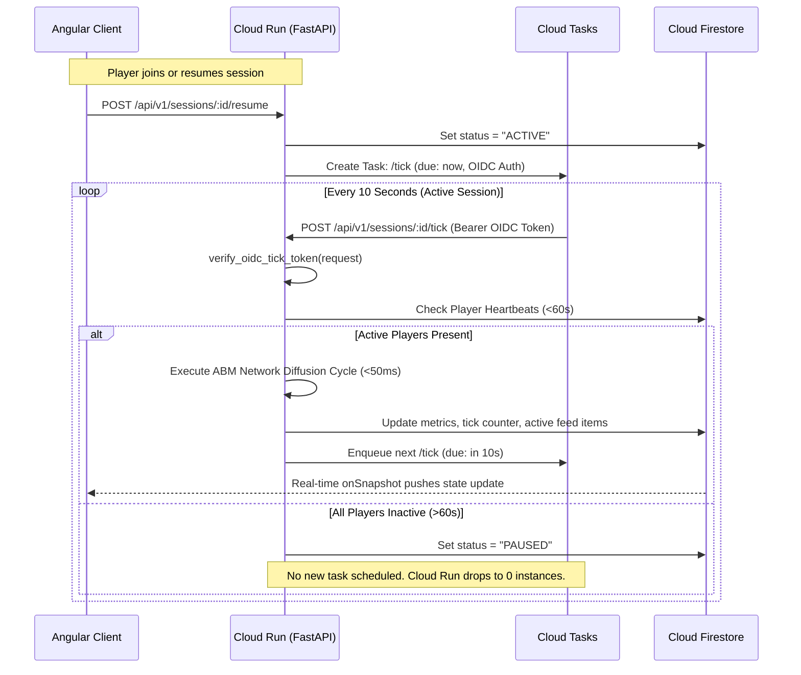
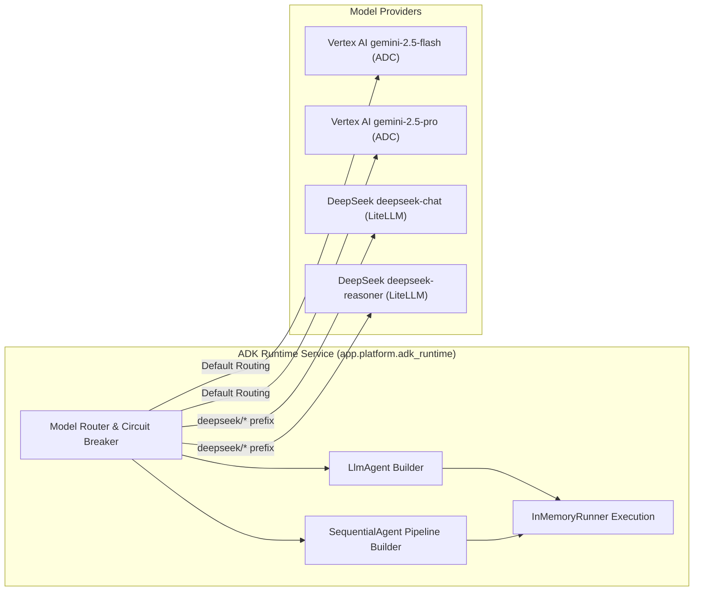

# Technical Specification: Infosphere Digital Hygiene Platform (`v3.0.0`)

## 1. System Overview & Architectural Strategy

The **Infosphere Digital Hygiene Platform (`v3.0.0`)** is an enterprise-grade agentic simulation, educational laboratory, and cyber-cognitive defense platform. Originally architected as a single-module disinformation simulator (`v2.1.0`), the platform has evolved through a **Strangler-Fig / Plugin-Core Migration** into a unified 5-module platform that models the full spectrum of modern information and social engineering threats.

### 1.1 Core Architectural Principles
1. **Google ADK-First Multi-Agent Systems (`google-adk`)**: All generative workflows across Modules 1–5 are orchestrated via `google.adk.agents` (`LlmAgent`, `SequentialAgent`), `google.adk.tools.FunctionTool`, and `google.adk.runners.InMemoryRunner`, enforcing strictly typed Pydantic v2 `output_schema` contracts.
2. **Keyless Vertex AI via Application Default Credentials (ADC)**: Static `GEMINI_API_KEY` configurations are eliminated. All Gemini calls (`gemini-2.5-flash`, `gemini-2.5-pro`) and dense vector embeddings (`text-embedding-004`) authenticate via Vertex AI ADC (`GOOGLE_GENAI_USE_VERTEXAI=TRUE`, `genai.Client(vertexai=True)`), governed by Cloud Run service account IAM roles (`roles/aiplatform.user`).
3. **Pluggable Multi-Provider Architecture (DeepSeek via LiteLLM)**: In Module 2, the adversarial `ScamOperativeAgent` can be dynamically switched between Vertex AI Gemini and DeepSeek (`deepseek/deepseek-chat`, `deepseek/deepseek-reasoner`) via ADK's `LiteLlm` provider using `DEEPSEEK_API_KEY` retrieved from Google Cloud Secret Manager. Defensive grading is independently preserved on governed Vertex AI (`gemini-2.5-pro`).
4. **Hybrid Multi-Corpus RAG Engine**: Combines sparse BM25 term weighting and dense vector cosine similarity via Reciprocal Rank Fusion (RRF with constant $k=60$), validated by an automated citation verification engine asserting explicit bracketed source tags.
5. **Standardized STIX 2.1 Threat Intel Integration**: Consolidates multi-module diagnostic results into a **Digital Hygiene Passport** with exportable OASIS STIX 2.1 JSON bundles for seamless integration into SIEM, SOAR, and Threat Intelligence Platforms.
6. **True Scale-to-Zero Serverless Economics**: Inactive labs incur zero compute costs. Simulation clock ticks and background tasks run asynchronously on Cloud Run Gen2 instances backed by Cloud Tasks and Cloud Pub/Sub, automatically self-terminating when all participants disconnect.
7. **Zero Spec-vs-Code Discrepancies & 100% Backward Compatibility**: Legacy routes (`/api/v1/sessions/*`, `/api/v1/invites/*`, `/api/v1/actions/*`, `/api/v1/admin/*`) remain fully supported, while the 5 modular domain routers are mounted under `/api/v1/modules/*`.
8. **Deterministic Zero-Credential Fallback**: Every AI inference call, RAG retrieval, and cloud service includes an offline, deterministic fallback so unit, integration, and CI/CD test suites pass 100% without external credentials or network connectivity.

---

## 2. Target System Architecture

```mermaid
flowchart TD
    subgraph ClientTier ["Frontend Presentation & Reactive State (Angular 19)"]
        SHELL["Platform Shell Navigation<br/>(Signals + Tailwind CSS + Lato Font)"]
        M1_VIEW["Module 1: Macro Disinfo Arena & HUD"]
        M2_VIEW["Module 2: Scam & Phishing Resilience Lab"]
        M3_VIEW["Module 3: Deepfake & Synthetic Media Lab"]
        M4_VIEW["Module 4: OSINT & DLP Exposure Lab"]
        M5_VIEW["Module 5: Echo Chamber & Recommender Lab"]
        SHELL --> M1_VIEW & M2_VIEW & M3_VIEW & M4_VIEW & M5_VIEW
    end

    subgraph APITier ["FastAPI Unified Application (Cloud Run Gen2)"]
        INGRESS["FastAPI Router /api/v1/*"]
        SEC_HEADERS["Security Headers Middleware<br/>(X-Content-Type-Options, X-Frame-Options, HSTS)"]
        LEGACY_ROUTER["Legacy Simulation Endpoints<br/>(/api/v1/sessions, /actions, /invites)"]
        MODULAR_ROUTER["Modular Plugin Endpoints<br/>(/api/v1/modules/{m1..m5}/*)"]
        CORE_ENDPOINTS["Platform Core Endpoints<br/>(/healthz, /readyz, /platform/modules, /passport)"]
        
        INGRESS --> SEC_HEADERS
        SEC_HEADERS --> LEGACY_ROUTER & MODULAR_ROUTER & CORE_ENDPOINTS
    end

    subgraph PlatformCore ["Platform Core Engine Layer"]
        REGISTRY["Plugin Registry (DigitalHygieneModulePlugin)"]
        ADK_RUNTIME["ADK Runtime & Model Router<br/>(3-State Circuit Breaker)"]
        RAG_ENGINE["Hybrid Multi-Corpus RAG Engine<br/>(BM25 + Cosine + RRF k=60 + Citation Verifier)"]
        DLP_GUARD["DLP Guardrail & Injection Firewall<br/>(PII Redaction: PESEL, SSN, IBAN, EXIF)"]
        PASSPORT_SVC["Digital Hygiene Passport Service<br/>(Overall Index + STIX 2.1 Bundle Export)"]
        TELEMETRY_SVC["Telemetry & Metrics Service<br/>(P50/P95/P99 Tracking + Pub/Sub Publisher)"]
        
        REGISTRY --> ADK_RUNTIME & RAG_ENGINE & DLP_GUARD & PASSPORT_SVC & TELEMETRY_SVC
    end

    subgraph AIProviders ["Multi-Model AI Infrastructure"]
        VERTEX_ADC["Keyless Vertex AI ADC<br/>(GOOGLE_GENAI_USE_VERTEXAI=TRUE)<br/>• gemini-2.5-flash<br/>• gemini-2.5-pro<br/>• text-embedding-004"]
        DEEPSEEK_LITELLM["External Model Bridge (ADK LiteLlm)<br/>• deepseek/deepseek-chat<br/>• deepseek/deepseek-reasoner"]
        ZERO_FALLBACK["Zero-Credential Deterministic Fallback"]
        
        ADK_RUNTIME --> VERTEX_ADC & DEEPSEEK_LITELLM & ZERO_FALLBACK
        RAG_ENGINE --> VERTEX_ADC & ZERO_FALLBACK
    end

    subgraph StorageCloud ["Google Cloud Managed Services"]
        FIRESTORE[(Cloud Firestore Native Mode<br/>Session States & Network Snapshots)]
        CLOUDTASKS[Cloud Tasks<br/>simulation-ticks-queue]
        CLOUDPUBSUB[Cloud Pub/Sub<br/>Topic: session-ai-tasks]
        GCS_STORAGE[(Cloud Storage<br/>Assets, Media Samples & Avatars)]
        SECRET_MGR[Cloud Secret Manager<br/>DEEPSEEK_API_KEY]
    end

    ClientTier -->|HTTPS REST Bearer / Signed JWT| INGRESS
    FIRESTORE -.->|onSnapshot Real-time Sync + Polling Fallback| ClientTier
    MODULAR_ROUTER --> REGISTRY
    LEGACY_ROUTER --> REGISTRY
    CLOUDTASKS -->|POST /api/v1/sessions/:id/tick (OIDC)| INGRESS
    ADK_RUNTIME -.-> SECRET_MGR
    TELEMETRY_SVC -.-> CLOUDPUBSUB
```

### 2.1 Component Mapping & Cost Profile

| Component | Target Service | Scaling Policy | Justification & Zero-Cost Behavior |
| :--- | :--- | :--- | :--- |
| **Frontend Delivery** | Cloud Storage + CDN / Static Web Hosting | Edge Static Delivery | Zero server compute; global edge caching; free-tier static hosting. |
| **Unified API & Engine** | Cloud Run Gen2 (FastAPI Container) | `minScale: 0`, `maxScale: 100`, `cpu-throttling: true` | Scales to 0 when inactive. Handles user actions, AI calls, and simulation ticks. |
| **Simulation Ticker** | Cloud Tasks | Serverless Push Queue | Fires discrete ticks every 10s. Self-terminates on player disconnect (scale-to-zero). |
| **State Streaming** | Cloud Firestore | Serverless Native Mode | Document-level `onSnapshot` real-time push with fallback polling to all connected clients. |
| **Async Task Pipeline** | Cloud Pub/Sub (`session-ai-tasks`) | Fully Managed Message Bus | Offloads heavy LLM narrative and forensic generation from the sub-second tick loop. |
| **Generative AI** | Vertex AI (Keyless ADC) + LiteLLM | On-demand API calls | Pay-per-token inference with 3-tier Token Governor and offline seed circuit breakers. |
| **Asset Storage** | Cloud Storage (GCS) | Multi-Region Bucket | Stores media samples, deepfake audio/video clips, and verified provenance manifests. |
| **Secret Management** | Cloud Secret Manager | Secret Version Access | Secures external third-party keys (`DEEPSEEK_API_KEY`) without hardcoding in environments. |

---

## 3. Scale-to-Zero Simulation Clock & Lifecycle

### 3.1 The Serverless Ticking Mechanism
Cloud Run containers with `cpu-throttling: true` freeze CPU execution between HTTP requests, preventing persistent in-memory `setInterval` loops. The platform leverages Cloud Tasks to orchestrate a distributed, self-driving clock:

1. A session is initialized with `status = "LOBBY"`.
2. When the Facilitator starts the scenario, the API transitions the session to `status = "ACTIVE"`, saves initial state to Firestore, and enqueues a Cloud Task targeting:
   `POST /api/v1/sessions/{sessionId}/tick` with an execution delay of `0` seconds.
3. Upon receiving the tick request:
   - The engine validates the request using Google Cloud OIDC token verification (`verify_oidc_tick_token`).
   - The engine checks player heartbeats (`last_seen < 60s`).
   - If active players exist:
     - The ABM social network diffusion cycle advances by 1 tick (representing 1 hour of operational time).
     - Macro metrics and updated feed items are computed and committed to Firestore.
     - The next tick is enqueued in Cloud Tasks with `scheduleTime = now + 10s`.
   - If no active player heartbeats exist within 60 seconds:
     - The session transitions to `status = "PAUSED"` in Firestore.
     - No further Cloud Task is scheduled.
     - Cloud Run scales down to zero instances.
4. When any player reconnects or the instructor clicks "Resume", the API receives the request, sets `status = "ACTIVE"`, and dispatches the kickoff Cloud Task.



---

## 4. Agent-Based Simulation (ABM) Engine & Propagation Calculus

### 4.1 Network Graph Topology
The Module 1 audience is modeled as a directed scale-free network (Barabási–Albert with clustering) composed of $N = 500$ discrete persona nodes partitioned into 5 ideological clusters:
* **Hyper-Partisan A**: High ideological bias ($B_i \approx -0.8$), elevated outrage sensitivity ($O_i \approx 0.85$).
* **Hyper-Partisan B**: Opposite ideological bias ($B_i \approx +0.8$), elevated outrage sensitivity ($O_i \approx 0.85$).
* **Institutional Skeptics**: Low baseline trust ($T_i \approx 0.25$), moderate bias, high confirmation bias.
* **Susceptible Neutrals**: Neutral bias ($B_i \approx 0.0$), moderate trust, susceptible to emotional framing.
* **Apolitical Youth**: Low baseline political engagement, sensitive to novelty and peer amplification.

Each node $i$ maintains discrete cognitive attributes:
* $T_i \in [0.0, 1.0]$: Institutional Trust.
* $O_i \in [0.0, 1.0]$: Outrage Sensitivity.
* $B_i \in [-1.0, 1.0]$: Ideological Bias.
* $C_i \in [0.0, 1.0]$: Confirmation Bias Strength.
* $M_i \in [0.0, 1.0]$: Prebunk Resistance Factor (inoculation).
* $\text{state}_i \in \{\text{UNAWARE}, \text{EXPOSED}, \text{BELIEVING}, \text{SHARING}, \text{DEBUNKING}\}$.

### 4.2 Vectorized Diffusion Mathematics
For each active post $k$ on tick $t$:
1. **Exposure Probability**:
   $$P(\text{Expose}_{i,k}) = 1 - \prod_{j \in \text{Sharers}(k)} (1 - w_{j,i}) \times (1 - \text{AlgoBoost}_k)$$
2. **Amplification / Reshare Probability**:
   $$P(\text{Share}_{i,k}) = \sigma \left( \alpha \cdot \text{Outrage}_k \cdot O_i + \beta \cdot (1 - |B_i - \text{Bias}_k|) \cdot C_i - \gamma \cdot \text{PrebunkShield}_{i,k} - \delta \cdot \text{FactCheckFriction}_k \right)$$
   where $\sigma(x) = \frac{1}{1 + e^{-x}}$, $\alpha = 2.0$, $\beta = 1.5$, $\gamma = 2.5$, $\delta = 1.8$.
3. **Trust Erosion & Recovery Dynamics**:
   - If node $i$ accepts an uncorrected disinforming post:
     $$T_i(t+1) = \max\left(0.0, T_i(t) - 0.05 \times (1 - M_i) \times \text{Outrage}_k\right)$$
   - If node $i$ encounters an evidence-based debunk:
     $$T_i(t+1) = \min\left(1.0, T_i(t) + 0.04 \times M_i\right)$$
4. **Macro Indices (Bounded $[0.0, 100.0]$)**:
   - **Virality Index ($V_t$)**: $100 \times \left( \frac{\text{Total Shares in Tick } t}{N_{\text{active}}} \right) \times \lambda_{\text{decay}}$.
   - **Polarization Score ($P_t$)**: $100 \times \sqrt{\frac{1}{N} \sum_{i=1}^N (B_i(t) - \bar{B})^2}$.
   - **Institutional Trust Index ($T_t$)**: $100 \times \frac{1}{N} \sum_{i=1}^N T_i(t)$.
   - **Disinformation Reach ($R_t$)**: Percentage of nodes in $\text{BELIEVING}$ or $\text{SHARING}$ state for disinfo.
   - **Debunk Effectiveness ($E_t$)**: Percentage of exposed nodes successfully transitioned to $\text{DEBUNKING}$.

### 4.3 Snapshot Persistence Across Scale-to-Zero
To prevent in-memory split-brain conditions across Cloud Run restarts, `AudienceNetwork` serializes its complete state via `FirestoreService.save_network_snapshot(session_id, network.to_dict())` and reconstitutes it via `FirestoreService.load_network_snapshot(session_id)` during tick execution.

---

## 5. Google ADK Multi-Agent Architecture

The platform standardizes all generative workflows on the **Google Agent Development Kit (`google-adk`)**.



### 5.1 Multi-Tier Circuit Breaker
Cloud Run threads are protected from third-party API latency spikes by a 3-state circuit breaker:
* `CLOSED`: Normal operation; all requests pass through.
* `OPEN`: After 3 consecutive failed calls, trips for 30 seconds; instantly returns deterministic fallback outputs.
* `HALF_OPEN`: Allows a single canary request; transitions back to `CLOSED` on success or `OPEN` on failure.

### 5.2 Module Agent Patterns

| Module | Pattern | Agents & Tools | Primary Models |
| :--- | :--- | :--- | :--- |
| **M1: Disinfo** | Reactive LLM Personas | Influencer Personas + Red Narrative Generator | `gemini-2.5-flash` |
| **M2: Scam Lab** | Multi-Provider Function Calling + Judge | `ScamOperativeAgent` + 3 Tools + `ResilienceCoachAgent` | `gemini-2.5-flash` / `deepseek/deepseek-chat` (Operative), `gemini-2.5-pro` (Coach) |
| **M3: Deepfake** | Sequential Forensic Pipeline | `ProvenanceValidatorAgent` $\to$ `VisualAcousticForensicsAgent` $\to$ `DebunkBriefingAgent` | `gemini-2.5-flash`, `gemini-2.5-pro` |
| **M4: OSINT** | Sequential Recon & DLP | `HarvesterAgent` $\to$ `SpearPhishPretextAgent` $\to$ `DLPRemediationAgent` | `gemini-2.5-flash`, `gemini-2.5-pro` |
| **M5: Echo Lab** | Vector Recommender + Coach | `AlgorithmicCuratorAgent` + `DepolarizationCoachAgent` | `text-embedding-004`, `gemini-2.5-flash` |

---

## 6. Hybrid Multi-Corpus RAG Engine Specification

### 6.1 Dual-Stage Retrieval Mathematics
The platform implements [`MultiCorpusRAGEngine`](file:///home/admin_/info/backend/app/platform/rag_engine.py) to supply evidence-grounded truth across all five modules:
1. **Sparse BM25 Retrieval**:
   $$\text{Score}_{\text{BM25}}(D, Q) = \sum_{q \in Q} \text{IDF}(q) \cdot \frac{f(q, D) \cdot (k_1 + 1)}{f(q, D) + k_1 \cdot \left(1 - b + b \cdot \frac{|D|}{\text{avgdl}}\right)}$$
   where $k_1 = 1.5, b = 0.75$, and $\text{IDF}(q) = \ln\left(1 + \frac{N - n(q) + 0.5}{n(q) + 0.5}\right)$.
2. **Dense Vector Cosine Similarity**:
   $$\text{Score}_{\text{Dense}}(D, Q) = \frac{\mathbf{v}_Q \cdot \mathbf{v}_D}{\|\mathbf{v}_Q\| \|\mathbf{v}_D\|}$$
   utilizing 768-dimensional normalized vectors from Vertex AI `text-embedding-004` (with deterministic hash-projected fallback in offline environments).
3. **Reciprocal Rank Fusion (RRF $k=60$)**:
   $$\text{RRF\_Score}(d) = \frac{1}{60 + \text{rank}_{\text{BM25}}(d)} + \frac{1}{60 + \text{rank}_{\text{Dense}}(d)}$$

### 6.2 Grounded Citation Verification
To eliminate generative hallucinations, `verify_citations(text, retrieved)` parses LLM outputs for bracketed citations matching source identifiers (e.g., `[PSE-GRID-2026-001]`, `[ENISA-BEC-2026-01]`, `[EU-DSA-ART27]`). Responses without valid citations are flagged for coach review.

---

## 7. Privacy, Safety & DLP Guardrail Specification

The platform implements [`DLPGuardrailService`](file:///home/admin_/info/backend/app/platform/dlp_guardrail.py) as an in-flight security and privacy gateway:
* **Prompt-Injection Firewall**: Rejects adversarial prompts containing prompt overrides, jailbreaks, system prompt exfiltration, and destructive payloads (`drop table`, `rm -rf /`, `synthesize ricin`).
* **Automated DLP Sanitizer**: Strips sensitive personal identifiable information:
  * Polish PESEL & US SSN
  * International Bank Account Numbers (IBAN)
  * Corporate and Personal Email Addresses
  * Polish and International Telephone Numbers
  * High-Precision GPS EXIF Geolocation Coordinates

---

## 8. Digital Hygiene Passport & OASIS STIX 2.1 Specification

### 8.1 Multi-Dimensional Diagnostic Model
Learner competence is continuously mapped across 5 dimensions:
1. `m1_disinfo`: Macro Narrative & CIB Defense ($0.0\text{--}100.0$)
2. `m2_scam_lab`: Social Engineering & Phishing Resilience ($0.0\text{--}100.0$)
3. `m3_deepfake_lab`: Synthetic Media & Deepfake Literacy ($0.0\text{--}100.0$)
4. `m4_osint_exposure`: OSINT Footprint & DLP Hygiene ($0.0\text{--}100.0$)
5. `m5_algo_echo`: Algorithmic & Echo-Chamber Autonomy ($0.0\text{--}100.0$)

**Overall Hygiene Index**:
$$\text{OHI} = \frac{1}{5} \sum_{m=1}^5 \text{Score}_m$$

### 8.2 STIX 2.1 Threat Intel Mapping
`GET /api/v1/platform/passport/{subject_id}/stix21` generates a valid STIX 2.1 JSON bundle:
```json
{
  "type": "bundle",
  "id": "bundle--3d7b8723-5e92-498b-90f1-4db8a92ef670",
  "spec_version": "2.1",
  "objects": [
    {
      "type": "identity",
      "spec_version": "2.1",
      "id": "identity--8a32d1ef-21f4-4a25-9831-7b029230514a",
      "created": "2026-10-03T08:00:00Z",
      "modified": "2026-10-03T08:00:00Z",
      "name": "Infosphere Digital Hygiene Subject (demo_user)",
      "identity_class": "individual"
    },
    {
      "type": "report",
      "spec_version": "2.1",
      "id": "report--d41c97a8-12ba-449e-b247-cb7340248a73",
      "created": "2026-10-03T08:00:00Z",
      "modified": "2026-10-03T08:00:00Z",
      "name": "Digital Hygiene Posture Report: RESILIENT_DEFENDER",
      "description": "Overall Hygiene Index: 84.2/100",
      "published": "2026-10-03T08:00:00Z",
      "report_types": ["threat-actor", "indicator"]
    }
  ]
}
```

---

## 9. The 5 Domain Modules: Operational Specification

### 9.1 Module 1: Macro Disinformation ABM Lab (`m1-disinfo`)
* **Scenarios**: `poland-grid-panic-2026`, `financial-panic-2026`, `water-contamination-2026`, `border-security-2026`.
* **Red Actions**: `Deploy Bot Swarm`, `AI Deepfake Article`, `Microtarget Cluster`, `Astroturf Comment Storm`.
* **Blue Actions**: `Prebunk Campaign`, `Evidence Debunk`, `Algorithmic Velocity Friction`, `Public Advisory`.
* **Endpoints**:
  * `POST /api/v1/modules/m1-disinfo/sessions`: Create simulation session.
  * `POST /api/v1/modules/m1-disinfo/sessions/{id}/start`: Start session ticker.
  * `POST /api/v1/modules/m1-disinfo/sessions/{id}/actions`: Execute team action.
  * `POST /api/v1/modules/m1-disinfo/sessions/{id}/tick`: Execute discrete graph diffusion step.

### 9.2 Module 2: Scam & Phishing Resilience Lab (`m2-scam`)
* **Scenarios**: `bec-ceo-wire-2026` (Urgent CEO Escrow Wire), `it-mfa-reset-2026` (AiTM MFA Reset).
* **Models**: `gemini-2.5-flash`, `deepseek/deepseek-chat`, `deepseek/deepseek-reasoner`.
* **Tools**: `inspect_sender_headers`, `lookup_domain_whois`, `verify_out_of_band_callback`.
* **Endpoints**:
  * `POST /api/v1/modules/m2-scam/drills`: Start interactive drill session.
  * `POST /api/v1/modules/m2-scam/drills/turn`: Process user turn, execute invoked tools, return coach grade.
  * `GET /api/v1/modules/m2-scam/models`: List available adversarial & coach models.

### 9.3 Module 3: Deepfake & Synthetic Media Literacy Lab (`m3-deepfake`)
* **Samples**: Video snippets, audio voice clones, and authentic press briefings.
* **Checks**: C2PA digital signatures (`VALID_SIGNED`, `STRIPPED_OR_MISSING`, `TAMPERED_SIGNATURE`), SynthID frequency watermarks, acoustic cutoffs, corneal reflection asymmetry.
* **Endpoints**:
  * `GET /api/v1/modules/m3-deepfake/samples`: Catalog of media artifacts.
  * `POST /api/v1/modules/m3-deepfake/inspect`: Run 3-agent forensic inspection pipeline.

### 9.4 Module 4: OSINT & Exposure Management Lab (`m4-osint`)
* **Checks**: Automated DLP redaction of submitted bios, simulated attacker pretext synthesis, GDPR Art. 5 checklist.
* **Endpoints**:
  * `POST /api/v1/modules/m4-osint/analyze`: Submit profile text, receive exposure score and sanitized output.

### 9.5 Module 5: Algorithmic Manipulation & Echo Chambers Lab (`m5-echo`)
* **Parameters**: Outrage weight ($W_{\text{outrage}}$), Topical affinity ($W_{\text{affinity}}$), Bridging diversity ($W_{\text{bridging}}$).
* **Metrics**: Shannon Viewpoint Entropy ($H$), Echo Chamber Radius ($R_{\text{echo}}$), Polarization drift alerts.
* **Regulatory Grounding**: EU Digital Services Act (DSA) Articles 27 & 38.
* **Endpoints**:
  * `POST /api/v1/modules/m5-echo/simulate-feed`: Run recommender simulation under custom weight parameters.

---

## 10. Authentication & Dual-Key Token Security

### 10.1 Magic Join URLs & Dual-Key JWT Rotation
To enable frictionless participant onboarding without static accounts, the platform issues cryptographically signed JWT tokens embedding session ID, role (`RED_TEAM`, `BLUE_TEAM`, `OBSERVER`), and expiration:
* **Dual-Key Rotation Engine**: `AuthService` signs tokens with `JWT_SECRET` and validates against both `JWT_SECRET` and `JWT_PREVIOUS_SECRET`, ensuring zero-downtime key rotation in enterprise environments.

### 10.2 Cloud Tasks OIDC Authentication
The discrete simulation clock endpoint (`POST /api/v1/sessions/{id}/tick`) is protected by `verify_oidc_tick_token`:
* Cloud Tasks attaches an OIDC token issued to service account `infosphere-engine-sa`.
* The endpoint verifies token signature against Google's public OAuth2 certificates, asserting audience match against `SERVICE_URL`.

---

## 11. Infrastructure as Code & Continuous Delivery

Infrastructure is codified in Terraform ([`terraform/`](file:///home/admin_/info/terraform)):
* `main.tf`: Enables required Google Cloud APIs, configures Cloud Run Gen2, Cloud Tasks, Cloud Firestore, Cloud Pub/Sub, Cloud Storage, and IAM roles.
* `variables.tf` & `outputs.tf`: Parameterizes environment resources and exposes service URIs.
Continuous delivery is automated via [`backend/cloudbuild.yaml`](file:///home/admin_/info/backend/cloudbuild.yaml), building multi-stage container images and deploying to Cloud Run with enforced IAM authentication.

---

## 12. Role Separation, Cohort Play Configuration & Gamified Progress Tracking

### 12.1 Identity Architecture & Role Separation (Player vs Admin)
The platform enforces strict separation of concerns between **Admins** (instructors, security directors, facilitators) and **Players** (trainees, analysts, operators):
* **Admin Capabilities**:
  * Create, configure, and monitor organizational cohorts.
  * Define module parameters (target pass scores, points values, allowed LLM providers, and scenario templates) per cohort.
  * Access real-time cohort analytics (completion rates, score distribution, risk identification).
* **Player Capabilities**:
  * Individual authenticated access via JWT credentials.
  * Execute drills and simulations across M1–M5 according to their cohort's configuration.
  * Accumulate points, unlock defense badges, and track progress via the dedicated Player Dashboard.
  * Generate and export updated Digital Hygiene Passports (STIX 2.1).

### 12.2 Cohort Play Configuration Engine
Cohorts define organizational training scopes with customized play parameters:
* **Cohort Schema**:
  * `id`: Unique identifier (e.g., `cohort_cyber_defense_2026`).
  * `name`: Descriptive cohort name.
  * `module_configs`: Custom hyperparameters per module:
    * `m1_disinfo`: Scenario ID, max simulation ticks, point allocation.
    * `m2_scam_lab`: Allowed generative operative models, passing score threshold.
    * `m3_deepfake_lab`: Forensic verification threshold and point allocation.
    * `m4_osint_lab`: DLP hardening pass score and point allocation.
    * `m5_algo_echo`: Target Shannon entropy, maximum echo-chamber radius, and point allocation.
  * `assigned_user_ids`: Enrolled player accounts.

### 12.3 Gamification, Points & Progress Tracking
Learners earn points and unlock badges by completing module challenges:
* **Completion & Scoring Pipeline**:
  1. Learner finishes an interactive drill or exercise in M1, M2, M3, M4, or M5.
  2. The exercise score is evaluated against the cohort's passing threshold.
  3. Points are awarded and added to the player's total.
  4. The module is marked completed, and earned badges (`SCAM_RESILIENT`, `SYNTHID_FORENSIC`, `DLP_GUARDIAN`, `ECHO_CHAMBER_BREAKER`, `DISINFO_DEFENDER`) are unlocked.
  5. The result is synchronized with `DigitalHygienePassportService`, updating the learner's overall hygiene index and maturity tier.

