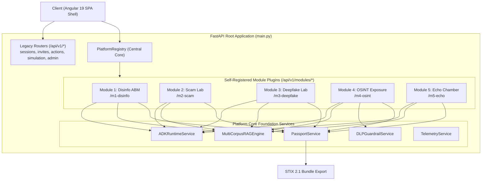

# ADR 005: Strangler-Fig Migration and Five-Module Plugin Architecture via PlatformRegistry

* **Status**: Accepted
* **Date**: 2026-10-03
* **Deciders**: Lead Architect, Frontend Architect, Backend Engineering Team
* **Technical Story**: Evolve Infosphere from a single-module disinformation game into an extensible 5-module digital hygiene platform with 100% backward compatibility and unified resilience tracking

---

## 1. Context and Problem Statement

Infosphere `v2.1.0` was architected as a specialized, single-purpose application modeling Baltic electrical grid disinformation via an Agent-Based Model (ABM). To meet the holistic training mandates of modern cyber-defense operators, `v3.0.0` expands the platform into a comprehensive **5-Module Digital Hygiene & Information Defense Platform**:
1. **Module 1**: Coordinated Disinformation & Kinetic Grid Contagion (ABM Virality)
2. **Module 2**: Generative Social Engineering & Scam Resilience Lab (Adversarial Multi-Turn)
3. **Module 3**: Synthetic Media & Deepfake Provenance Lab (C2PA / SynthID Forensics)
4. **Module 4**: OSINT Exposure & Automated DLP Remediation Lab (Reconnaissance Defense)
5. **Module 5**: Algorithmic Manipulation & Echo Chambers Lab (Recommender Auditing)

Crucially, this architectural expansion had to satisfy three hard constraints:
1. **100% Backward Compatibility**: All legacy client endpoints (`/api/v1/sessions/*`, `/api/v1/invites/*`, `/api/v1/actions/*`, `/api/v1/simulation/*`, `/api/v1/admin/*`) must remain fully functional without breaking existing clients or test suites.
2. **Modular Decoupling**: Each module must maintain its own domain models, routing logic, evaluation test cases, and ADK pipeline definitions, avoiding monolithic router file bloat.
3. **Unified Educational Identity**: A user's performance across all 5 distinct modules must aggregate into a coherent scoring ledger (**Digital Hygiene Passport**) exportable in standardized threat intelligence formats (STIX 2.1).

---

## 2. Considered Architectural Options

### Option A: Monolithic Extension (Appended Routers in `api/v1/`)
* **Mechanism**: Directly append new endpoints to existing router files (e.g., adding deepfake and scam routes into `api/v1/actions.py` and `api/v1/simulation.py`).
* **Flaws**:
  - Severe architectural degradation; creates an unmaintainable god-router.
  - High probability of merge collisions across concurrent development teams.
  - No clean way to enumerate, discover, or selectively enable/disable modules.

### Option B: Microservices Decomposition (Separate Cloud Run Services per Module)
* **Mechanism**: Deploy 5 independent Cloud Run microservices (one per module) behind an API Gateway or Cloud Load Balancer.
* **Flaws**:
  - High operational complexity: 5 separate CI/CD pipelines, container builds, and Cloud Tasks queues.
  - Cold-start multiplication across services.
  - Cross-service shared state (e.g., the user's unified `DigitalHygienePassport` and shared `AudienceNetwork`) would require distributed database transactions and inter-service authentication overhead.

### Option C: Strangler-Fig Pattern with Platform Core & Plugin Registry (Selected)
* **Mechanism**:
  - **Strangler-Fig Invariant**: Legacy `/api/v1/*` routes remain mounted unchanged on the root FastAPI application.
  - **Plugin-Core Architecture**: Define a `DigitalHygieneModulePlugin` protocol and a central `PlatformRegistry` in `backend/app/platform/plugin_registry.py`.
  - **Autonomous Self-Registration**: Each module lives in its own package (`backend/app/modules/mX_*/plugin.py`) implementing `get_metadata()`, `get_router()`, and `get_golden_eval_cases()`. When imported, the plugin registers itself with `platform_registry.register(plugin)`.
  - **Dynamic Route Mounting**: The root application iterates over registered plugins and mounts their routers under `/api/v1/modules/{route_prefix}`.
  - **Shared Platform Services**: Cross-cutting concerns (`adk_runtime`, `rag_engine`, `dlp_guardrail`, `passport_service`, `telemetry_service`) are injected into plugins via a clean platform boundary.

---

## 3. Decision Outcome

**Chosen Option**: **Option C (Strangler-Fig Pattern with Platform Core & Plugin Registry)**.

### Architectural Invariants:
1. **Plugin Contract (`DigitalHygieneModulePlugin`)**:
   ```python
   class DigitalHygieneModulePlugin(Protocol):
       def get_metadata(self) -> ModuleMetadata: ...
       def get_router(self) -> APIRouter: ...
       def get_golden_eval_cases(self) -> List[GoldenEvalCase]: ...
   ```
2. **Dynamic Mounting in `backend/app/main.py`**:
   ```python
   # 1. Mount Legacy Endpoints (100% Backward Compatibility)
   app.include_router(sessions_router, prefix="/api/v1")
   app.include_router(invites_router, prefix="/api/v1")
   app.include_router(actions_router, prefix="/api/v1")
   app.include_router(simulation_router, prefix="/api/v1")
   app.include_router(admin_router, prefix="/api/v1")

   # 2. Mount All 5 Modular Platform Routers under /api/v1/modules/{m1-disinfo..m5-echo}
   platform_registry.mount_all_routers(app, base_prefix="/api/v1/modules")
   ```
3. **Cross-Module Passport Ledger**:
   - `PassportService` records exercise completions and scores across all 5 modules.
   - Calculates the `overall_hygiene_index` as an equally weighted mean across active dimensions.
   - Computes maturity tiers (`VULNERABLE_INITIATE`, `AWARE_OPERATOR`, `RESILIENT_DEFENDER`, `EXEMPLAR_GUARDIAN`).
   - Exposes a STIX 2.1 Course-of-Action and Identity bundle (`/api/v1/platform/passport/{user_id}/stix21`) for enterprise SIEM/SOAR ingestion.

---

## 4. Architecture & Module Structure



---

## 5. Consequences & Trade-offs

### Positive Consequences
* **Zero Disruption Migration**: Existing tests, scripts, and frontends targeting `/api/v1/sessions` continue functioning with zero modifications.
* **Independent Scalability & Ownership**: Each module operates as an isolated sub-package with its own schemas and test suites, enabling concurrent engineering without merge collisions.
* **Automated Discovery & Evaluation**: `platform_registry.collect_all_eval_cases()` enables unified regression testing across all 5 modules with a single test runner.
* **Enterprise Threat Intel Interoperability**: The STIX 2.1 export bridges educational exercise results with operational Security Operations Center (SOC) tooling.

### Negative Consequences & Mitigations
* **Single Monolith Process Deployment**: All 5 modules share the same Python process and memory space.
  - *Mitigation*: Modular isolation prevents memory leakage; memory limits on Cloud Run Gen2 are provisioned at 1GiB with automatic horizontal scaling up to 100 instances.
* **Module Import Order Dependency**: Plugins must be imported before mounting routers.
  - *Mitigation*: Explicit imports in `backend/app/main.py` guaranteed by module import declarations and automated test verification.

---

## 6. Verification and Compliance
* Automated verification via:
  - `backend/tests/integration/test_platform_modules.py::test_platform_registers_all_five_modules`
  - `backend/tests/eval/test_golden_eval_suite.py`
* Confirms zero orphan code: all 5 modules are registered in `PlatformRegistry`, exposed in `/api/v1/platform/modules`, and mounted under `/api/v1/modules/*`.
